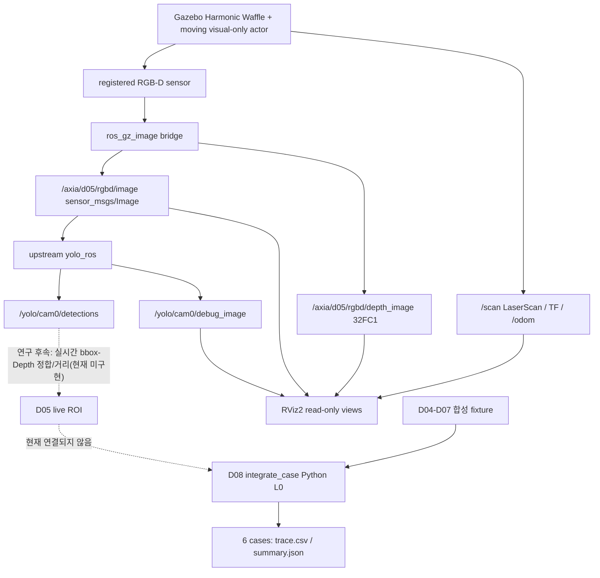

# AXIA D08 — 학생용 Gazebo + YOLO + RViz2 Live Demo (연구 관측판)

> **2026-11-18 WSLg 3D 렌더 보정 후보:** 기존 센서 Live는 성공했지만 Owner가 확인한 **Gazebo 흰 화면·RViz 검은 3D 화면**은 별도의 실패다. D07-H01의 SceneBroadcaster·서버 후 GUI 기동 복원과 공식 Nav2 메시 경로를 재사용한 [D08 GUI 복원 후보 실행 가이드](D08_WSLG_GAZEBO_RVIZ_RENDER_RESTORE_20261118_KO.md)를 우선 확인한다. 공개 실 Gazebo L2는 PASS지만, Owner WSLg 화면의 픽셀 인수는 아직 **NOT_VERIFIED**다. 기존 성공 데모와 결과 폴더는 보존한다.

**기준:** ROS 2 Jazzy / Gazebo Harmonic / 공식 Nav2·TurtleBot3 Waffle / Ubuntu 24.04 WSL2 + WSLg. **학습 시간:** D08(2026-11-18) 첫 시간 중 15~20분 관찰, 이후 6개 Python 합성 사례 TDD·통합 설명에 연결한다.

> **학습 목표**: (1) Visionㆍ거리정보 기반 Human-aware Safety 제어 흐름 구성, (2) 사람 인식ㆍ거리계산ㆍ회피제어 통합 실습. 이 Live는 **관측 센서 계층**, 별도 D08 Python 실습은 **판단 계층**이다. 실제 회피제어/Goal은 인수되지 않았으며 자동 실행하지 않는다.

## 1. 기능 범위 — 검증된 코드를 재사용한다

- **Gazebo**: 기존 공개 D04/D05 공식 Waffle 시뮬레이션, 움직이는 사람형 **visual-only** Actor, 정지 Waffle, 등록된 RGB-D 1개. visual-only Actor는 LiDAR가 감지하는 실제 충돌 장애물이라고 주장할 수 없다.
- **YOLO**: 기존 upstream C++ `yolo_ros` + 고정된 ONNX 모델, `/yolo/cam0/debug_image`의 동적 Bounding Box. `/yolo/cam0/detections`은 별도 ROS 메시지 확인.
- **RViz2**: **구독 전용** RobotModel(/robot_description), TF, LaserScan(/scan), Odometry(/odom), D05 등록 RGB(/axia/d05/rgbd/image), Depth(/axia/d05/rgbd/depth_image), YOLO debug 이미지. Fixed Frame=`odom`; RViz 파일에 Nav2 Goal/Initial Pose 발행 도구 없음.
- **Python D08**: `block_B/day08/integration_todo.py`의 6개 **합성** 사례에만 적용, 라이브 ROS 토픽→`integrate_case`는 미연결. 합성 판단 산출물은 **`verified_level=PYTHON_ONLY`**로 표시한다. 실제 `distance_m`·`/axia/d05/person_range_status`는 이 **학생 센서 전용** 모드에서 제공하지 않는다.
- **안전 계층**: 실제 공식 Collision Monitor·Guard→`/cmd_vel`·Moving Goal·E-Stop 종단은 이번 학생 시연에서 **NO_GOAL / NOT_VERIFIED**. 화면의 교육용 정책을 실제 안전제어로 오인 금지. SW Stop ≠ 인증된 HW E-Stop.

### 데이터 흐름과 모니터링 지점



**중요:** RViz2에서 Depth 영상이 보이더라도 bbox-Depth **ROI 거리 계산이 수행됐다는 뜻은 아니다**. `/scan`은 실제 LiDAR 관측이지만 이 visual-only Actor의 물리 충돌·제어·정지 성공은 검증하지 않는다. 녹화에는 `/tf`와 `/tf_static`도 같이 포함해야 프레임 재현에 도움이 된다.

## 2. 단일 WSL2 실행 — 기존 개인 과제·가상환경 보존

학생의 기존 D04~D08 TODO 작업 디렉터리를 수정하지 않고 **별도 공개 시연용 폴더**에 클론한다. 공개 브랜치의 CI 상태를 확인한 뒤 실행한다. 준비 명령을 하나의 Bash 블록으로 실행할 수 있다.

```bash
(
  set -Eeuo pipefail
  SCRIPT="$(mktemp)"
  trap 'rm -f -- "$SCRIPT"' EXIT
  curl -fL --retry 3 --max-time 90 \
    "https://raw.githubusercontent.com/silverbjin/axia-robot-safety-student/a5f1cee52bbfa07578ddb40b9c28e8c23e742449/block_B/day08/run_d08_student_live_bootstrap.sh" \
    -o "$SCRIPT"
  bash -n "$SCRIPT"
  AXIA_D08_DOMAIN_ID=49 AXIA_D08_HOLD_S=300 bash "$SCRIPT" --run
)
```

**WSL2 `AMENT_TRACE_SETUP_FILES: unbound variable` 회귀 해결:** 예전 명령의 `set -Eeuo pipefail` 뒤 **직접 `source /opt/ros/jazzy/setup.bash`**가 최초 실패 지점이었다. 새 단일 실행 명령은 외부 셸에서 ROS를 소싱하지 않고 검증된 내부 D08→D04 실행기에서 `set +u; source; set -u`로 처리한다. 원격 스크립트는 **Git SHA 고정**으로 내려받으며 실행기와 CI가 동일한 공개 코드를 사용한다. 학생의 `~/axia_d08_student_live` 및 가상환경·증거를 삭제하지 않는다. 기존 브랜치·수정이 있으면 안전하게 차단한다.

`--self-check`는 **정적 검사만** 수행한다. `--doctor`는 Jazzy/공식 ROS 패키지/RViz 준비 상태를 검사하고 Gazebo는 실행하지 않는다. `--run`만 실제 Gazebo·YOLO·RViz2를 시도한다. 실습 플랫폼에 `rviz2`가 없으면 `D08_RVIZ2_NOT_INSTALLED`로 차단하므로 설치 뒤 재실행한다. WSLg `DISPLAY`가 없으면 기존 런처가 차단한다. `AXIA_D08_HOLD_S=300`은 시연 관찰용 300초이며 **비동기 백그라운드 데몬을 남기지 않는다.**

### 세 개의 관찰 창

| 화면 | 눈으로 확인할 내용 | 실제 의미 |
|---|---|---|
| **Gazebo Harmonic** | Waffle, 다가왔다 멀어지는 시각용 사람 | 시뮬레이션 장면·Actor 애니메이션 |
| **YOLO image_view** | 움직이는 person bbox·confidence | RGB 이미지에서 검출한 결과 |
| **RViz2 D08 view** | RobotModel, TF, /scan, /odom, D05 RGB/Depth, YOLO debug | **ROS 메시지의 실시간 구독 표시**. Live D05 미터 계산 아님 |

**정상일 때 예상되는 로그 패턴(새로 실행한 실측값 아님):**

```text
D08_STUDENT_LIVE_LAUNCH_REQUESTED: Gazebo + moving visual-only person + RGB-D + YOLO + RViz2
D08_STUDENT_LIVE_READONLY: NO_GOAL NO_CMD_VEL NO_PRIVATE_D05_RANGE NO_SAFETY_TTL
D04_STUDENT_GAZEBO_LAUNCHED: GUI startup requested; NOT yet verified
D05_LIVE_VERDICT={"status":"PASS_REAL_GAZEBO_REGISTERED_RGBD_YOLO_MOVING_BBOX_ONLY",...}
D05_PUBLIC_SENSOR_ONLY_PASS REAL_RGBD_YOLO PRIVATE_D05_RANGE_NOT_RUN
```

`LAUNCH_REQUESTED`는 세 창이 **실제로 나타났다는 증거가 아니다**. 기존 검증기가 ROS RGB/Depth·YOLO 데이터를 확인해야 센서 Live로 판정한다. Gazebo/YOLO/RViz **세 창의 실제 표시**는 학생 WSL2 화면에서 별도로 확인한다. 녹화·스크린샷 1장과 종료 코드·verdict 원본을 같이 남기면 좋다.

## 2-A. Owner WSL2 현장 실행 기록과 인수 판정 (2026-11-15)

**현장 결과: `OWNER_WSL2_SENSOR_LIVE_PASS` — Gazebo·RGB-D·YOLO 센서 Live 및 소유 실행기 정상 종료.** 위 SHA 고정 원샷을 **기존 `~/axia_d08_student_live` 폴더에 재실행**한 실제 Owner 로그를 기준으로 한다. 테스트용으로 만든 출력이나 CI 예상값이 아니다. 공개 Student `main`에 병합된 실행기 바이트는 현장 소스 SHA와 동일함이 확인되었으며, 이 항목을 이유로 기존 정상 실행을 반복하지 않는다.

```text
D08_STUDENT_RELEASE_SOURCE_SHA=6a007eafa36957f17dc3e57e1a2e4acf3f3af5bd
D08_LIVE_RVIZ_STATIC_PASS GAZEBO_NOT_RUN RVIZ_NOT_RUN YOLO_NOT_RUN NO_GOAL
D04_STUDENT_PROCESS_STARTED name=gazebo_nav2 pid=1863
D04_STUDENT_PROCESS_STARTED name=camera_bridge pid=1864
D04_STUDENT_PROCESS_STARTED name=depth_bridge pid=1865
D04_STUDENT_PROCESS_STARTED name=yolo_ros pid=1866
D04_STUDENT_PROCESS_STARTED name=image_view pid=1867
D04_STUDENT_PROCESS_STARTED name=rviz2 pid=1868
D05_LIVE_VERDICT={"status":"PASS_REAL_GAZEBO_REGISTERED_RGBD_YOLO_MOVING_BBOX_ONLY","passed":true,"phase":"sensor","registered_rgbd_pairs":9,"rgb_frames":11,"depth_frames":13,"yolo_frames":4,"person_count":2,"bbox_area_span":0.2539007134522838,"valid_samples":0,"min_distance_m":null,"max_distance_m":null,"goal_sent":false,"cmd_vel_published":false,"certified_estop":false}
D05_PUBLIC_SENSOR_ONLY_PASS REAL_RGBD_YOLO PRIVATE_D05_RANGE_NOT_RUN
D04_STUDENT_GUI_HOLD_STARTED seconds=300; press Ctrl+C when finished
D04_STUDENT_DEMO_COMPLETE: live RGB+YOLO checked
D04_STUDENT_SHUTDOWN: stopping only child process groups
D04_STUDENT_EXIT_CODE=0
```

| 관찰 항목 | 현장 근거와 해석 | 판정 |
|---|---|---|
| ROS Jazzy + Gazebo 실제 센서 전달 | `source=ACTUAL_ROS_GAZEBO`, RGB 11, Depth 13, 등록된 RGB-D 9쌍 | **PASS** |
| 동적 YOLO 사람 검출 | YOLO 프레임 4, `person_count=2`, `bbox_area_span=0.2539007134522838` | **PASS** (관측 게이트) |
| ROS·GUI 프로세스 기동 | `gazebo_nav2`, `image_view`, `rviz2` PID 생성 | **PASS** (프로세스 시작) |
| WSLg에 세 창의 실제 표시, RViz 각 패널의 픽셀·토픽 시각화 | 창 스크린샷·화면 판독 기록 미제공 | **`RVIZ_PANEL_VISUAL_NOT_VERIFIED`** |
| 실제 YOLO bbox+Depth ROI 거리(m) | `valid_samples=0`, `min_distance_m=null`, `max_distance_m=null`, `PRIVATE_D05_RANGE_NOT_RUN` | **NOT_RUN** |
| 이동·충돌 회피·정지 안전제어 | `goal_sent=false`, `cmd_vel_published=false`, `NO_GOAL` | **NOT_RUN** |
| 소유 실행기 종료 | `D04_STUDENT_SHUTDOWN` 및 `D04_STUDENT_EXIT_CODE=0` | **PASS** |

`not found: ".../install/local_setup.bash"` 메시지 2개는 현재 셸에 남은 **이전 D03 교육용 ROS overlay 경로를 찾지 못했다는 경고**로 해석한다. 이 실행에서는 이후 ROS·Gazebo·YOLO 관측과 종료 코드가 정상이라 **이번 센서 Live 실패 원인은 아니었다.** 그렇다고 누락된 기존 overlay가 필요한 다른 ROS 프로젝트까지 정상이라고 판단하지 않는다. 환경변수·overlay를 임의로 삭제하거나 전체 WSL2를 초기화하지 않는다.

**학생 현장 확인(추가 설치·재주행 없이):** 실행 중 Gazebo 사람 이동, YOLO bbox, RViz2의 `/scan`·TF·RGB·Depth 표시를 눈으로 확인한다. 확인 가능한 화면이 없다면 `RVIZ_PANEL_VISUAL_NOT_VERIFIED` 상태를 유지한다. `D08_LIVE_RVIZ_STATIC_PASS`는 **실제 Gazebo 실행 전의 정적 검사**이므로 Live PASS의 근거로 단독 사용하지 않는다.

**수업에서의 경계:** 움직이는 사람 Actor는 `visual-only`다. `person_count=2`는 메시지 관측 건수이며 `2명`이라는 뜻이 아니다. 학생에게 실제 거리·`Collision Monitor`·Guard 150ms TTL·실제 주행/회피 및 인증 E-Stop 성공이라고 설명하지 않는다. D08 최종 Python 합성 실습의 `PYTHON_ONLY`와 센서 Live 성과는 **서로 별도의 검증 레벨**이다.

## 3. RViz2 표시가 비었을 때 (코드 수정 전 진단)

RViz2 파일: `block_B/day08/live/d08_student_rgbd_monitor.rviz`. **D04 기본 설정의 RGB**는 `/camera/image_raw`이지만 **D08 관측 모드의 실제 RGB**는 `/axia/d05/rgbd/image`다. 새 설정은 이 불일치를 수정한다.

- **Fixed Frame:** `odom`; 일부 TF가 미생성일 때 `map`을 임의로 사용하지 않는다. Waffle이 정지해 있어도 TF·Odom을 볼 수 있다.
- **LaserScan:** `/scan` / Best Effort, 실제 Gazebo 레이저 관측. **visual-only Actor가 점군에 안 보이는 것은 예상 가능한 결과**다.
- **D05 Registered RGB:** `/axia/d05/rgbd/image`, `sensor_msgs/msg/Image`.
- **D05 Depth 32FC1:** `/axia/d05/rgbd/depth_image`, `sensor_msgs/msg/Image`; RViz Image의 normalize 기능을 사용. Depth 표시는 **거리 측정 수치**가 아니다.
- **YOLO Debug Image:** `/yolo/cam0/debug_image`, person bbox 표시.
- **Object-level DetectionArray:** RViz 기본 Image 플러그인은 `yolo_msgs/msg/DetectionArray` 객체의 필드를 표로 표시하지 않는다. **터미널 B**에서 확인한다. RViz의 Path/Collision Monitor 상태는 이번 장면에서 발행 증거가 없어 추가하지 않았다.
- **GPU 부하:** Gazebo+YOLO+RViz 렌더링을 동시에 사용하므로 프레임이 느리면 시각화 패널을 잠시 숨기고 센서 토픽의 실제 wall-time 수신 간격을 먼저 확인한다. 실제 RGB-D 메시지 timestamp가 맞더라도 수신 간격(안전 TTL)은 별도다.

## 4. 터미널 B — 실제 ROS 토픽 읽기 전용 진단

터미널 A에서 세 창이 실행 중일 때, 같은 WSL2 배포판에서 **터미널 B**를 연다.

```bash
set +u
source /opt/ros/jazzy/setup.bash
set -u
# upstream yolo_ros custom DetectionArray의 타입을 터미널 B/C에서 해석하려면
# 먼저 기존 D04 원샷의 고정 SHA 메시지 overlay를 소싱한다.
YOLO_OVERLAY="$HOME/.cache/axia/d04/yolo_ws_94d2dd500cb26027ee9c019f4d3a02029ac615cc/install/setup.bash"
if [[ -r "$YOLO_OVERLAY" ]]; then set +u; source "$YOLO_OVERLAY"; set -u; fi
export ROS_DOMAIN_ID=49
export ROS_AUTOMATIC_DISCOVERY_RANGE=LOCALHOST
ros2 topic list | grep -E '^(/scan|/odom|/tf|/axia/d05/rgbd/(image|depth_image)|/yolo/cam0/(detections|debug_image))$'
ros2 topic info /axia/d05/rgbd/depth_image --verbose
ros2 topic echo /axia/d05/rgbd/depth_image --field encoding --once
ros2 topic hz /scan
```

**기대 관측:** Depth encoding은 `32FC1`이며 `/scan`은 실제 구독 Hz가 출력된다. `ros2 topic hz`는 종료할 때 B에서 **Ctrl+C**. 메시지 간격과 GUI 프레임율은 WSL2 자원 상황에 따라 달라서 **실측 전 숫자를 약속하지 않는다**. YOLO 검출은 다음으로 타입과 데이터를 확인한다.

```bash
ros2 topic info /yolo/cam0/detections --verbose
ros2 topic echo /yolo/cam0/detections --once
```

**주의:** `ros2 topic echo`로 표시되는 class·score·bbox와 이미지 header stamp를 따로 관찰한다. RGB-D 정합의 `50ms` 교육 기준, track freshness `0.50s`와 실제 CM→Guard TTL `150ms`는 **서로 다른 제약**이다. YOLO가 검출한 person이 반드시 LiDAR 장애물이라는 주장은 하지 않는다.

## 5. 후속 연구 — 1회 rosbag 기록(선택, 관측 전용)

별도 **터미널 C**에서 센서와 관측 메타데이터를 모아 재현 데이터로 보존한다. 연구용으로만 권장하며 실시간 데모 우선 시에는 녹화하지 않아 프레임 지연을 줄인다.

```bash
set +u
source /opt/ros/jazzy/setup.bash
set -u
# upstream yolo_ros custom DetectionArray의 타입을 터미널 B/C에서 해석하려면
# 먼저 기존 D04 원샷의 고정 SHA 메시지 overlay를 소싱한다.
YOLO_OVERLAY="$HOME/.cache/axia/d04/yolo_ws_94d2dd500cb26027ee9c019f4d3a02029ac615cc/install/setup.bash"
if [[ -r "$YOLO_OVERLAY" ]]; then set +u; source "$YOLO_OVERLAY"; set -u; fi
export ROS_DOMAIN_ID=49
export ROS_AUTOMATIC_DISCOVERY_RANGE=LOCALHOST
mkdir -p "$HOME/axia_d08_research"
BAG="$HOME/axia_d08_research/bag_$(date -u +%Y%m%dT%H%M%SZ)_$$"
ros2 bag record -o "$BAG" \
  /scan /odom /tf /tf_static \
  /axia/d05/rgbd/image /axia/d05/rgbd/depth_image \
  /yolo/cam0/detections
# 10~30초 정도 관찰 후 이 터미널에서 Ctrl+C
ros2 bag info "$BAG"
```

**제출할 증거:** 자신의 `git rev-parse HEAD`, `live_verdict.json`, 화면 캡처, 토픽 목록·형식, rosbag 메타데이터/원본 파일 해시. bag에는 영상이 포함되므로 외부 공개 전 개인정보·라이선스·용량을 검토한다.

**후속 연구 순서(이번 실습의 필수 개발이 아님):** (1) 라이브 bbox+Depth 정합을 읽기 전용으로 관측하고 신선도·첫 타이밍 위반 계측, (2) 비충돌 인식 및 위치 TF 연관성 검증, (3) 공개 실제 Gazebo D08 물리 사람 proxy와 **visual-only** Actor 차이를 분석, (4) 독립적인 D07 H01 실제 이동·CM→Guard 종단이 CI/Owner WSL2에서 인수된 뒤에만 경로·정지 모니터링 확장.

## 6. 종료·오류 분리·검증 레벨

- **정상 종료:** 실행 소유자인 터미널 A에서 **Ctrl+C**. 기존 D04 런처가 자신이 시작한 Gazebo·ROS·RViz 자식 프로세스 그룹만 종료한다. `pkill`, `wsl --shutdown`, 글로벌 ROS 환경 변경 금지.
- **먼저 볼 로그:** `$HOME/axia_d04_student_evidence/d04-gazebo-*/live_verdict.json`, 같은 폴더 `gazebo_nav2.log`, `camera_bridge.log`, `depth_bridge.log`, `yolo_ros.log`, `rviz2.log` (생성된 경우). 최초 실패 데이터 전달·최초 타이밍 위반부터 해석한다.
- **통과 조건:** 세 GUI가 실제 열리고 RGB·Depth·YOLO·RViz 주요 구독 표시, 센서 Live verdict, 종료 시 프로세스 재생성 없음. GUI는 CI 가상 디스플레이 PASS와 사용자 WSLg PASS를 구분한다.
- **기존 검증:** D04 공개 실 Gazebo·YOLO GUI [Run #43166756309](https://github.com/silverbjin/axia-robot-safety-student/actions/runs/43166756309); D05 실제 registered RGB-D/움직이는 Actor YOLO [Run #43353480617](https://github.com/silverbjin/axia-robot-safety-student/actions/runs/43353480617); D08 별도 near/far 물리 모델·ROS YOLO 영상 재생 [Run #43676658454](https://github.com/silverbjin/axia-robot-safety-ci-public/actions/runs/43676658454). **서로 다른 소스 SHA·검증 범위를 하나의 동시 실행 성공으로 합치지 않는다.**
- **최종 검증 경계(2026-11-15):** 동일 부트스트랩의 공개 CI 실제 Gazebo+YOLO+RViz2 **Xvfb L2** [Run #43703627239](https://github.com/silverbjin/axia-robot-safety-student/actions/runs/43703627239) PASS, 원샷 nounset 회귀 및 공개 L0 [Run #43704267580](https://github.com/silverbjin/axia-robot-safety-student/actions/runs/43704267580) 23 passed. 이 문서의 Owner 로그로 **실제 WSL2 센서 Live + 종료는 PASS**, 다만 RViz 화면 실물·개별 패널 시각 정상 여부는 `RVIZ_PANEL_VISUAL_NOT_VERIFIED`. 본 문서 추가 변경은 내용·증거 안내만이며 ROS 실행기 원본은 변경하지 않는다.
