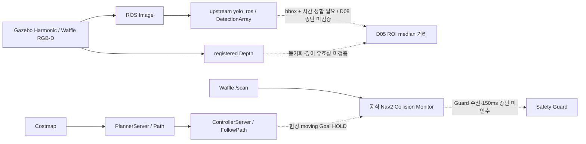
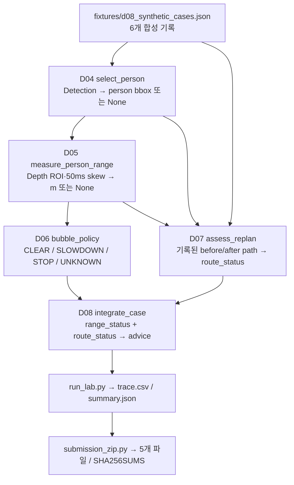

# AXIA D08 — 학생용 데모 가이드 V2 (2026-11-18, 온라인 4시간)

> **Live 관찰 옵션:** [D08 Gazebo + YOLO + RViz2 연구용 화면 가이드](D08_GAZEBO_RVIZ_LIVE_GUIDE_20261115_KO.md) — 실제 RGB-D·YOLO·TF·LiDAR 화면을 보고 기존 합성 판단과 구분한다. Moving Goal·D05 학생 실측 거리 계산은 포함하지 않는다.

> **대응 슬라이드:** D08 V2 32장 중 01·03·04·07·09·17·20·22–27·32. 이 문서는 **학생이 직접 관찰하는 데모**이다. 단계별 구현·제출은 [학생용 실습 가이드 V2](D08_STUDENT_PRACTICE_GUIDE_V2_20261115_KO.md)를 따른다.

## 0. 오늘의 두 학습 목표

1. **Visionㆍ거리정보 기반 Human-aware Safety 제어 흐름 구성**
2. **사람 인식ㆍ거리계산ㆍ회피제어 통합 실습**

이 수업의 제어 흐름은 **시스템 구조 이해 + 교육용 Python 판단**까지다. 실제 `NavigateToPose` 이동, `/cmd_vel` 발행, Guard 보호정지 또는 인증 E-Stop 구동을 새로 인수하는 시간이 아니다.

## 1. ① 실제 ROS 2 시스템 아키텍처(설명·기존 공개 증거용)



- **관측:** RGB의 `person` 분류는 거리 측정이 아니다. 유효한 bbox, 등록 Depth, 최근 프레임의 timestamp가 모두 필요하다.
- **계획:** PlannerServer가 경로를 계산해도 ControllerServer가 실제 경로를 따라 주행했다는 증거는 아니다.
- **보호:** 실기 안전 경로는 LiDAR/`/scan` → **Collision Monitor** → Guard·베이스 명령 계통으로 설명한다. 아래 합성 D06 `bubble_policy`가 실제 Collision Monitor를 대체하지 않는다.
- **검증 경계:** 실시간 카메라→map의 사람 좌표 TF, moving Goal, CM→Guard 수신 TTL, 무충돌 주행·제동 dwell은 D08에서 **NOT_VERIFIED / HOLD**다. SW Stop은 인증된 HW E-Stop이 아니다.

## 2. ② 학생이 직접 실행하는 합성 데이터 파이프라인



화살표는 **Python 값 전달**이다. ROS 토픽·실제 `/cmd_vel` 경로가 아니다. 합성 `person_xy=[0.8,0.0]`은 카메라 bbox에서 TF로 변환한 실제 사람 위치가 아니라 학습 데이터의 가정이다. 결과는 `source=D08_SYNTHETIC_CLASSROOM`, `verified_level=PYTHON_ONLY`로 남는다.

## 3. 준비 및 관찰 데모 — 터미널 하나 (ROS·Gazebo 설치 불필요)

저장소를 처음 받았다면 다음 명령을 실행한다. 이미 다른 작업 디렉터리에 수정한 D04–D07 실습 파일이 있다면 **덮어쓰거나 reset하지 않는다.** 새 디렉터리에 복제한 코드는 이전 과제 구현을 자동으로 포함하지 않는다.

```bash
git clone --branch main --single-branch https://github.com/silverbjin/axia-robot-safety-student.git
cd axia-robot-safety-student
python3 -m venv .venv
source .venv/bin/activate
python -m pip install 'pytest==8.3.5'
```

먼저 **학생 TODO가 미구현이어도 성공하는** 공개 스캐폴드·제출 안전 계약을 확인한다.

```bash
PYTEST_DISABLE_PLUGIN_AUTOLOAD=1 python -m pytest -q block_B/day08/tests/test_d08_public.py::test_d08_synthetic_fixture_contract block_B/day08/tests/test_d08_submission_zip.py block_B/day08/tests/test_d08_v2_guide_contract.py
```

**예상 출력:** `14 passed` (fixture 1 + ZIP 9 + V2 문서 계약 4), 종료 코드 0. 이는 `integrate_case()` 구현 완료가 **아니다**.

그다음 구현 전 RED를 관찰한다.

```bash
PYTEST_DISABLE_PLUGIN_AUTOLOAD=1 python -m pytest -q block_B/day08/tests/test_d08_public.py
```

**기본 저장소의 예상 출력:** `1 passed, 2 failed`와 `TODO_D08_INTEGRATE_CASE` (정상적인 교육용 RED). 기존 D04–D07 코드가 미구현이면 해당 실패가 추가될 수 있다.

## 4. 학생이 읽을 핵심 코드·입출력

| 순서 | 실제 파일의 공개 함수 | 대표 입력 | 반환 / 설명 |
|---|---|---|---|
| D04 | `block_B/block_b_todo.py::select_person` | `detections` + confidence 0.91, 유효 bbox | `person` 또는 `None` |
| D05 | `block_B/block_b_todo.py::measure_person_range` | 4×4 Depth, bbox ROI, RGB/Depth stamp | `1.30` m 또는 `None` |
| D06 | `block_B/day06/safety_bubble_todo.py::bubble_policy` | distance + valid + age | `CLEAR/SLOWDOWN/STOP/UNKNOWN`과 `expected_ratio` |
| D07 | `block_B/day07/route_todo.py::assess_replan` | 기록 경로 before/after, 합성 person_xy | `REPLAN_EVIDENCED/NOT_VERIFIED/UNKNOWN` |
| D08 | `block_B/day08/integration_todo.py::integrate_case` | 6개 case와 routes | `advice`, evidence flags 포함 dict |

실습 임계값은 **교육 fixture 용도**다: RGB-D 허용 시간차 `0.05s`, track 최대 나이 `0.50s`, D06 STOP `0.40m`, 감속 `0.75m`, D07 buffer `0.35m`. 실제 CM/Guard의 TTL이나 인증 파라미터로 오인하지 않는다.

## 5. 강사가 화면에서 비교할 6개 사례 — 구현 완료 후 기대값

| case_id | 관측 거리·실패 원인 | range_status | route_status | 최종 advice |
|---|---|---|---|---|
| `clear_replan` | 1.30 m | CLEAR | REPLAN_EVIDENCED | REPLAN_REVIEW |
| `slow` | 0.65 m | SLOWDOWN | REPLAN_EVIDENCED | SLOWDOWN_EXPECTED |
| `stop` | 0.30 m | STOP | REPLAN_EVIDENCED | STOP_EXPECTED |
| `lost` | person 미검출 | UNKNOWN | UNKNOWN | UNKNOWN_REVIEW |
| `stale_depth` | RGB/Depth 0.20s 차이 | UNKNOWN | UNKNOWN | UNKNOWN_REVIEW |
| `stale_track` | person age 0.80s | UNKNOWN | UNKNOWN | UNKNOWN_REVIEW |

**예상 출력 (GREEN 완료자의 결과):**
```text
D08_PYTHON_FIXTURE_REPLAY_PASS cases=6 out=results/d08_run1
case_id,person_detected,distance_m,range_status,route_status,advice,expected_ratio
clear_replan,True,1.3,CLEAR,REPLAN_EVIDENCED,REPLAN_REVIEW,1.0
...
stale_track,True,,UNKNOWN,UNKNOWN,UNKNOWN_REVIEW,
```

실제 row 구분·소수점·bool 표기는 실행기 Python 버전에 따라 위 예시처럼 표현된다. `STOP_EXPECTED`는 **교육용 조언 문자열**이지 실제 정지 모터 명령이 아니다. 거리 정책 UNKNOWN은 절대 CLEAR로 승격시키지 않는다.

## 6. 공개 실제 Gazebo·YOLO 증거 읽기 — 선택형 관찰(직접 주행 아님)

- [실제 Gazebo Waffle/사람 near→far, NO-GOAL L2](https://github.com/silverbjin/axia-robot-safety-ci-public/actions/runs/43676658454): 근접 실제 LiDAR 약 **0.361795m**, 복귀 후 약 **1.420888m**; native pose ACK 확인, Goal 미발행.
- 동일 CI의 **고정된 RGB 프레임 재생 L1**: upstream C++ `yolo_ros` DetectionArray에서 `person=3`, 최고 confidence 약 `0.54955`. **라이브 WSL2 RGB-D+D05 종단 성공과는 다르다.**
- [실제 현장 오류 진단 활동](D08_FIELD_DIAGNOSTIC_CASE_KO.md): `person=0 / umbrella=64`, 최근 RGB-D skew 198ms > 허용 50ms. 두 실패 경계를 구분하고 거리만 원인이라 단정하지 않는다.

질문: (1) `person=0`인데 `CLEAR`를 낼 수 있는가? (2) 경로 변경 근거가 실제 주행 완료를 증명하는가? (3) LiDAR/Collision Monitor의 역할과 합성 `bubble_policy`의 역할은 왜 다른가?

## 7. 데모 종료 및 검증 수준

학생은 `deactivate`로 venv를 종료한다. **`PYTHON_ONLY`**, `robot_moved=false`, `collision_free_verified=false`, `control_published=false`, `safety_certified=false`, `ros_verified=false`, `gazebo_verified=false`가 이 과제의 올바른 증거 표시다.

본 데모가 직접 실행한 것은 Python fixture와 의도된 TODO RED이며, 실제 ROS 2 주행·Nav2 moving Goal·Guard TTL·안전 인증은 수행하지 않는다. 코드 구현·제출 세부 단계는 [학생용 실습 가이드](D08_STUDENT_PRACTICE_GUIDE_V2_20261115_KO.md)를 따른다.
