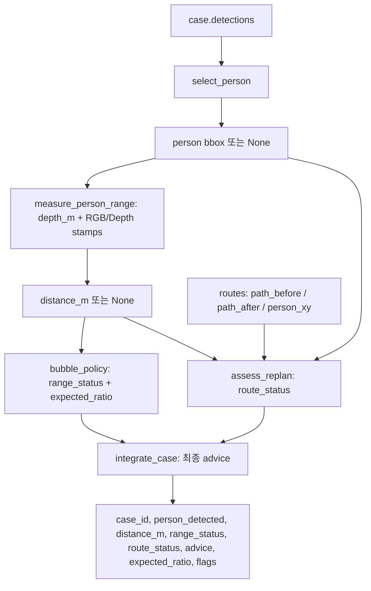

# AXIA D08 — 학생용 통합 실습 가이드 V2 (2026-11-18)

**교육 시간:** 2026-11-18(수) 19:00–23:00, 온라인 4시간. **필수 작업:** 기존 D04~D07 학생 TODO를 재사용해 D08 `integrate_case()` **1개 함수**만 구현하고 합성 6사례 결과 ZIP 1개를 제출한다.

## 1. 학습 목표와 최종 산출물

1. **Visionㆍ거리정보 기반 Human-aware Safety 제어 흐름 구성** — 시스템의 관측/계획/추종/보호 구조와 교육용 데이터 흐름을 구분해 설명한다.
2. **사람 인식ㆍ거리계산ㆍ회피제어 통합 실습** — D04 사람 후보, D05 Depth ROI, D06 거리별 정책, D07 기록 경로 평가를 호출해 `advice`를 만든다. 실제 구동 제어는 **수업 범위 밖**이다.

제출: `results/d08_submission.zip` **1개**. ZIP 내용은 `trace.csv`, `summary.json`, `pytest.txt`, `integration_todo.py`, `SHA256SUMS`의 **5개 파일만** 허용한다. 강사 솔루션·hidden tests·개인정보는 넣지 않는다.

[먼저 보는 시스템·파이프라인 데모](D08_STUDENT_DEMO_GUIDE_V2_20261115_KO.md) | [기존 D08 기본 가이드](D08_LAB_KO.md) | [실제 WSL2 오류 진단](D08_FIELD_DIAGNOSTIC_CASE_KO.md)

## 2. 4시간 학습 단계

| 시간 | 활동 | 완료 증거 |
|---|---|---|
| 19:00–20:00 | 아키텍처 / D04–D07 복습 / WSL2 `person=0`·skew 198ms 사건 진단 | 계층 2개 그림을 설명하고 오류 최초 경계를 말함 |
| 20:00–21:00 | 학생 TODO 1개 구현, RED→GREEN | `test_d08_public.py` 통합 2개 테스트 통과 |
| 21:00–22:00 | 6개 `fixtures/d08_synthetic_cases.json` 실행 및 우선순위 검토 | `trace.csv` 6행, `summary.json` 6개 결과 |
| 22:00–23:00 | pytest 실측 출력 기록, SHA256 ZIP 검사, 미검증 보고 | `D08_ZIP_HASH_VERIFY_PASS` |

## 3. 환경 준비 — 저장소 루트, 터미널 한 개

ROS 2, Gazebo, GPU는 **필요 없다**. Python 3.12+ 권장. 기존 학생 과제를 덮어쓰지 않도록 별도 복제 또는 사용 중인 작업 트리의 Git 변경 상태를 확인한다.

```bash
git clone --branch main --single-branch https://github.com/silverbjin/axia-robot-safety-student.git
cd axia-robot-safety-student
python3 -m venv .venv
source .venv/bin/activate
python -m pip install 'pytest==8.3.5'
mkdir -p results
```

이미 같은 폴더가 있다면 `git clone`을 반복하지 않는다. 본인이 구현했던 D04~D07 함수가 준비되어야 D08 통합 GREEN이 가능하다. **`git reset --hard` 금지**. 저장소 루트에서 확인할 파일:

```text
block_B/block_b_todo.py                  # D04 select_person / D05 measure_person_range
block_B/day06/safety_bubble_todo.py       # D06 bubble_policy
block_B/day07/route_todo.py              # D07 assess_replan
block_B/day08/integration_todo.py         # 이번 실습에서 수정할 단 하나의 TODO
block_B/day08/fixtures/d08_synthetic_cases.json
block_B/day08/run_lab.py
block_B/day08/submission_zip.py
block_B/day08/tests/test_d08_public.py
```

## 4. RED: 먼저 실패를 관찰

```bash
PYTEST_DISABLE_PLUGIN_AUTOLOAD=1 python -m pytest -q block_B/day08/tests/test_d08_public.py
```

기본 미구현 TODO 상태에서는 **`1 passed, 2 failed` + `NotImplementedError: TODO_D08_INTEGRATE_CASE`가 예상**된다. 이를 GREEN이라고 기록하지 않는다. fixture/ZIP 및 문서 자체의 공개 계약은 다음처럼 별개로 확인한다.

```bash
PYTEST_DISABLE_PLUGIN_AUTOLOAD=1 python -m pytest -q block_B/day08/tests/test_d08_public.py::test_d08_synthetic_fixture_contract block_B/day08/tests/test_d08_submission_zip.py block_B/day08/tests/test_d08_v2_guide_contract.py
```

**예상:** `14 passed`, D08 학생 통합 함수는 여전히 RED.

## 5. GREEN: 코드 한 곳에 기존 네 함수를 연결

편집 대상은 **`block_B/day08/integration_todo.py`의 `integrate_case(case: dict, routes: dict) -> dict`** 한 곳이다. 새 Nav2 Planner, ROS Action, Collision Monitor, `/cmd_vel` publisher는 구현하지 않는다.



### 단계별 구현 힌트 — 정답 코드 제공 아님

- **D04:** `select_person(case["detections"])`. 유효한 person·confidence·bbox만 선택한다. 사람이 없으면 `None`.
- **D05:** 사람이 확인됐을 때만 `measure_person_range(depth_m, person, frame_stamp_s, depth_stamp_s)` 호출. 4×4 ROI의 유효 Depth(m) 중앙값이 정상 예시 `1.30m`; RGB/Depth skew가 `0.05s` 초과면 `None`. `stale_depth`는 `0.20s`라 실패한다.
- **D06:** `bubble_policy(distance, valid=person_is_valid, age_s=person_age_s)`. 예시 기준 STOP `<=0.40m`, SLOWDOWN `<=0.75m`, 그밖에 CLEAR; 사람 노후 `age_s>0.50s` 또는 거리 미확인은 UNKNOWN. 이는 **교육용 정책**이며 공식 CM 파라미터가 아니다.
- **D07:** `assess_replan(path_before, path_after, person_xy, valid=valid_measurement, age_s=person_age_s)`. 원래 경로가 사람 보호 반경 0.35m에 막히고 변경 경로가 벗어났는지 **기록된 기하**를 평가한다. 실제 로봇 이동을 일으키지 않는다.
- **D08:** 정책과 경로의 결과를 합쳐 `advice`를 정한다. 반환 필드 이름과 자료형은 `integration_todo.py` docstring을 따른다. `source='D08_SYNTHETIC_CLASSROOM'`, `verified_level='PYTHON_ONLY'`; 모든 실세계 안전 증거 플래그는 `False`다.

### 판단 우선순위(흐름도 구현)

```text
range_status == UNKNOWN?  → UNKNOWN_REVIEW  (데이터 신뢰 불가)
range_status == STOP?     → STOP_EXPECTED  (검증된 가까운 거리 우선)
route_status == UNKNOWN?  → UNKNOWN_REVIEW
range_status == SLOWDOWN? → SLOWDOWN_EXPECTED
route_status == REPLAN_EVIDENCED? → REPLAN_REVIEW
그밖에                  → MONITOR_ONLY
```

**주의:** 유효한 `STOP`과 `UNKNOWN` 경로가 충돌하면 `STOP_EXPECTED`를 유지한다. 하지만 `stale_track`처럼 거리 정책이 **UNKNOWN**이면 과거 depth가 0.30m라도 `STOP`을 신뢰했다고 주장하지 않는다. UNKNOWN은 CLEAR이나 자동 재출발 허가가 아니다.

## 6. 여섯 사례 예상 결과 — 스스로 테스트하기

| case_id | 거리/원인 | D06 range_status | D07 route_status | D08 advice |
|---|---|---|---|---|
| `clear_replan` | 1.30m | CLEAR | REPLAN_EVIDENCED | REPLAN_REVIEW |
| `slow` | 0.65m | SLOWDOWN | REPLAN_EVIDENCED | SLOWDOWN_EXPECTED |
| `stop` | 0.30m | STOP | REPLAN_EVIDENCED | STOP_EXPECTED |
| `lost` | person 검출 없음 | UNKNOWN | UNKNOWN | UNKNOWN_REVIEW |
| `stale_depth` | stamp 차이 0.20s | UNKNOWN | UNKNOWN | UNKNOWN_REVIEW |
| `stale_track` | track age 0.80s | UNKNOWN | UNKNOWN | UNKNOWN_REVIEW |

예상 상태 벡터: `REPLAN_REVIEW, SLOWDOWN_EXPECTED, STOP_EXPECTED, UNKNOWN_REVIEW, UNKNOWN_REVIEW, UNKNOWN_REVIEW`.

## 7. 실제 실행 및 로그 보존

**D04~D07 선행 TODO와 D08을 모두 완성한 뒤에만** 아래 GREEN을 기대한다. 파이프라인 실패가 감춰지지 않도록 `set -o pipefail`을 유지한다.

```bash
set -o pipefail
PYTEST_DISABLE_PLUGIN_AUTOLOAD=1 python -m pytest -q block_B/tests block_B/day06/tests block_B/day07/tests block_B/day08/tests 2>&1 | tee results/d08_pytest_capture.txt
python -m block_B.day08.run_lab --out results/d08_run1
cat results/d08_run1/trace.csv
python -m json.tool results/d08_run1/summary.json | head -45
```

**예상(GREEN인 경우만):**
```text
D08_PYTHON_FIXTURE_REPLAY_PASS cases=6 out=results/d08_run1
case_id,person_detected,distance_m,range_status,route_status,advice,expected_ratio
clear_replan,True,1.3,CLEAR,REPLAN_EVIDENCED,REPLAN_REVIEW,1.0
...
```

미구현이면 `D08_LAB_BLOCKED:NotImplementedError:TODO_D08_INTEGRATE_CASE`, 종료코드 2가 정상이다. 출력이 성공이라고 기록되지 않는다. `results/d08_run1`이 이미 존재하면 **삭제하지 말고** `results/d08_run2` 같은 신규 이름을 사용한다.

## 8. pytest 증거와 ZIP 한 개 제출

```bash
cp results/d08_pytest_capture.txt results/d08_run1/pytest.txt
python -m block_B.day08.submission_zip --run-dir results/d08_run1 --out results/d08_submission.zip
python - <<'PY'
import hashlib, zipfile
with zipfile.ZipFile("results/d08_submission.zip") as z:
    expected={"trace.csv","summary.json","pytest.txt","integration_todo.py","SHA256SUMS"}
    assert set(z.namelist())==expected
    assert z.testzip() is None
    for line in z.read("SHA256SUMS").decode().splitlines():
        digest,name=line.split("  ")
        assert hashlib.sha256(z.read(name)).hexdigest()==digest
print("D08_ZIP_HASH_VERIFY_PASS")
PY
```

**정상 예상:** `D08_SUBMISSION_ZIP_PASS output=... files=5 PYTHON_ONLY`, 이어 `D08_ZIP_HASH_VERIFY_PASS`. 누락된 pytest 성공 로그, 안전 플래그 위조, symlink, 결과 불일치, 기존 ZIP 덮어쓰기는 거부한다. `SHA256SUMS`는 파일 무결성 점검이지 인증·신원 보증이 아니다.

## 9. 스스로 설명할 수 있는가? (제출 전 점검)

- D04 bbox가 유효해도 왜 D05 거리 값이 `None`이 될 수 있는가?
- 정상 거리 0.30m이더라도 `person_age_s=0.80`이면 왜 `UNKNOWN_REVIEW`인가?
- 기록된 두 경로의 `REPLAN_EVIDENCED`는 왜 실제 `ControllerServer` 주행 성공이 아닌가?
- 실제 `/scan` → 공식 Collision Monitor → Guard 안전 계층과 합성 `bubble_policy`를 구분했는가?
- 로그에 표시한 `robot_moved=false`, `collision_free_verified=false`, `control_published=false`, `safety_certified=false`, `ros_verified=false`, `gazebo_verified=false`가 모두 거짓으로 유지됐는가?

**평가:** 함수 재사용·기대 결과 6건·UNKNOWN 보수적 판단·실제 pytest 출력·ZIP 해시 5개 파일을 본다. **실제 이동 Goal, SW Stop, 인증 HW E-Stop, ROS/Gazebo 실행 결과는 이 교육용 ZIP으로 입증하지 않는다.** 실습 종료는 `deactivate`.
