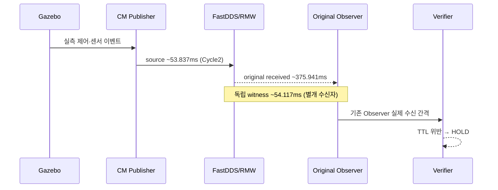

# AXIA DAY 02 — 완성 G07 MVP 시나리오 활용·강사 데모·학생 관측 가이드 v1.0

**기준:** 2026-11-26 · **운영 원칙:** 이미 검증된 G07 런타임과 실제 원본 데이터를 재사용합니다. 본 가이드의 `g07_scenario_replay.py`는 측정값을 순서대로 설명하는 **정적 증거 리플레이**입니다. `rosbag play`, 애니메이션, 실제 ROS/Goal/Gazebo 재실행이 아닙니다.

- **성공 원본 Student:** `f7edb2d126502eeeed58ae014adadc7a2096d41b`
- **성공 Public L2:** `64ba0161e66126b4743b4b12a859f4a5349ae58a`, [Run #44965035965](https://github.com/silverbjin/axia-robot-safety-ci-public/actions/runs/44965035965), **Native Moving 2/2 PASS**
- **Owner 실제 WSL2 L3:** [2026-11-22 공개 사후 원본 검수](https://github.com/silverbjin/axia-robot-safety-ci-public/blob/c2c4f66c532be2a41855239860b9a9f5d60c4586/docs/operations/AXIA_G07_OWNER_WSL2_L3_POSTRUN_RAW_EVIDENCE_REVIEW_20261122_KO.md), 수치·Goal UUID·Lifecycle **PASS_SCOPED**. 자동 `HOLD_RAW_REVIEW_AND_VISUAL_PENDING` 보존, 독립 GUI 콘텐츠 확인 없음
- **실패 심화 Student:** `a04f9a7da8d54bbd9f944d05388792cb706adf28`; Public `8e03ac0a912ca9b81bdddda70212e52e6d804389` / [#44914827138](https://github.com/silverbjin/axia-robot-safety-ci-public/actions/runs/44914827138) **Native Moving 0/2 FAIL**, Owner L3 NOT_RUN
- **교실용 데모 실행기:** `special_lecture/day02/scripts/g07_scenario_replay.py`; 학생용 독립 브랜치·소스 계약을 바꾸지 않고 추가한 읽기 전용 교육 코드

## 1. 누가 무엇을 실행합니까?

| 운영자 | 사용할 모드 | 실행 권한 및 검증 수준 |
|---|---|---|
| 학생 전체 | `--case success`, `--case failed`, `--case compare` | Python만 필요. 과거 승인/실패 증거를 분석. **신규 ROS/Gazebo 실행 없음** |
| 강사 (선택 NO_GOAL) | 기존 `d07_h01_gui_no_goal_once.sh` | 정지한 실제 시뮬레이션·RViz/Planner 흐름을 보여주는 **기존 D07 별도 실습**. 환경 필요, 현재 새 릴리스의 L2 재인수 증거는 없음 |
| 강사 (선택 Moving) | Public의 기존 `axia_g07_stabilization_wsl2_final_once.sh --run` | 별도 명시적 TTY 승인·강사 WSL2·Native CI 2-job 확인 이후 **단일 Moving 시연**. 학생용 원샷에 자동 포함하지 않음 |
| 실패본 심화 학습자 | 실패 소스와 고정 원본 기록을 읽고 개인 브랜치에서 분석 | 기존 **0/2 실패**, 임의 Goal 실행 금지. 새 CI Moving 2/2 없으면 수정 후보를 HOLD |

**중요:** 외부에 공개된 툴의 `--self-check` 또는 이 가이드의 L0 PASS는 로봇 물리 동작 성공의 재검증이 아닙니다.

## 2. 한눈에 보는 실제 G07 데이터 파이프라인

```mermaid
flowchart TD
 G[Gazebo Harmonic · Waffle LiDAR] --> B[ros_gz_bridge]
 B --> SC[/scan · LaserScan]
 SC --> INJ[Fault Injector]
 INJ --> SS[/safety/scan]
 SC --> NAV[Official Nav2 + Smoother]
 NAV --> SM[/cmd_vel_smoothed]
 SM --> SUP[Safety Supervisor]
 SS --> SUP
 SUP --> SV[/cmd_vel_supervised]
 SS --> CM[Collision Monitor]
 SV --> CM
 CM --> PG[/cmd_vel_pre_guard]
 PG --> GU[Base Guard · CM TTL 150ms]
 GU --> BASE[/cmd_vel · Gazebo Base]
 BASE --> OD[/odom · 실제 이동/정지]
 OD --> V[Scenario Verifier · Evidence]
```

Node는 실행 프로그램, Topic은 전달 채널, Message는 실제 값입니다. 예를 들어 Gazebo의 스캔 데이터가 ROS 2 `/scan`에 도착하고, Fault Injector가 안전 감시 채널 `/safety/scan`을 구성합니다. 주행 계획은 공식 Nav2의 역할, 보호 판단은 Supervisor/CM/Guard의 역할, 최종 이동 여부는 `/odom` 데이터로 판단합니다.

**학생에게 보여 줄 코드 경로 (성공 원본 SHA 기준)**

- `block_B/day07/h01_runtime/ros2_ws/src/axia_safety_bringup/launch/axia_tb3_p2.launch.py`: 공식 Nav2 및 자체 패키지 실행 구성
- `.../axia_safety_supervisor/p2_supervisor_node.py`: Supervisor FSM·상태·제어
- `.../axia_safety_supervisor/p2_base_guard_policy.py`: `CM_TTL_SEC = 0.15`, 최종 명령 게이트. **0.15초는 인증 E-Stop 성능이 아님**
- `block_B/day07/h01_runtime/configs/p2_collision_monitor_zones.yaml`: SLOW 0.75m, STOP 0.40m, ratio 0.30 **교육용 기하 설정**
- `block_B/day07/h01_runtime/tools/p2_g07_ci_moving_goal.py`: 실제 Goal·SLOW/STOP·Goal 취소·Odom 검증
- `block_B/day07/h01_runtime/tools/p2_g07_task03_contract.py`: Goal UUID terminal 5와 14토픽 증거의 읽기 전용 판정
- `block_B/day07/h01_runtime/tools/p2_g07_ordered_shutdown.py`: Navigation/Localization 종료 ACK

## 3. 학생 실습: 증거 리플레이로 장면 6개 재구성

**준비**: 2026-11-26의 성공본 릴리스가 GitHub에 게시된 것을 확인한 뒤 실행합니다. 해당 릴리스의 **프로젝트 README**에 따라 소스를 복제합니다.

```bash
cd ~/axia-day02-success
python3 special_lecture/day02/scripts/verify_release.py
python3 special_lecture/day02/scripts/g07_scenario_replay.py --case success
```

프로그램이 보여주는 **S01~S06은 실제 시뮬레이션 시간축의 재생 영상이 아니라 원본 보고서의 순서별 수치 카드**입니다.

| ID | 강사가 보여줄 장면 | 2026-11-22 Owner 실측 | 학생이 답할 질문 / 검증 |
|---|---|---|---|
| S01 · 준비 | Gazebo→Bridge→Scan/안전 노드 구조 | 실제 `/scan`, `/safety/scan` 사전 확인 | `/scan`과 `/safety/scan` 역할이 다른 이유는? |
| S02 · CLEAR | 로봇이 이동 가능한 구간 | 전방 2.048107m, CM 0.062925m/s, Guard 최종 0.037684m/s | Nav2 출력과 최종 속도가 반드시 같아야 하나요? |
| S03 · SLOW | 장애물 접근에 따른 감속 | 전방 0.674758m, CM 0.004810m/s, 최종 0.003422m/s | 화면상 거의 멈춘 것처럼 보일 수 있으므로 **실제 속도 수치**를 같이 확인합니다 |
| S04 · STOP | 소프트웨어 안전 정지 | 전방 0.396788m, CM 0, Guard 최종 0m/s | `/cmd_vel=0`만으로 정지가 증명되는가? `/odom`도 확인해야 합니다 |
| S05 · 취소·정지 유지 | 정확히 동일한 Nav2 Goal UUID의 종료 | `CANCELED(5)`, Goal cancel ACK, odom ZERO **1.026194649s**, 총 실제 이동 **0.129946523m** | 취소 서비스 응답과 Goal terminal 및 로봇 물리 정지의 차이는? |
| S06 · 정상 종료 | Nav/Loc ACK + 안전 노드 종료 | Navigation ACK, Localization ACK, CM exit0, **21개 프로세스 정상 종료** | 정상 종료 로그와 Lifecycle ACK가 각각 증명하는 것은? |

**추가 설명:** 이번 Owner 세션에서는 Contact 0을 확인했지만 **Positive Contact calibration은 이 세션에서 재수행하지 않았습니다.** SLOW polygon의 ratio=0.30은 설정값이며, 측정된 두 속도 값의 비율을 모두 그 polygon 하나가 결정했다고 단정하면 안 됩니다.

### 안전 타이밍 — 장면과 별도 검증

| 관측 계층 | 실측 최대값 | 기준 | 범위 한정 판정 |
|---|---:|---:|---|
| `/scan` 콜백 | 215.083ms | 300ms | 해당 Owner 실행에서 기준 이내 |
| `/clock` 콜백 | 95.139ms | 300ms | 기준 이내 |
| `/odom` 콜백 | 149.594ms | 300ms | 기준 이내 |
| CM `/cmd_vel_pre_guard` 콜백 | 71.460ms | 120ms | 기준 이내 |
| Guard 내부 CM age | 49.279ms | 150ms | 기준 이내 |

위 숫자는 **Owner WSL2의 한 번의 실제 실행 원본**으로부터 인용되었습니다. 새 수치 측정으로 취급하지 않습니다. 독립 GUI 화면 콘텐츠 검수, 장기 DDS 지연 원인, 인증된 E-Stop은 포함하지 않습니다.

### JSON 산출물 저장

```bash
mkdir -p "$HOME/axia-day02-evidence"
python3 special_lecture/day02/scripts/g07_scenario_replay.py \
  --case compare \
  --json-out "$HOME/axia-day02-evidence/scenario_compare.json"
```

출력 JSON의 `verification_level = HISTORIC_EVIDENCE_REPLAY_L0_ONLY`, `new_ros_gazebo_run=false`를 확인합니다. **기존 파일이 있으면 덮어쓰지 않고 중단**하므로, 반복할 때는 다른 출력 파일 이름을 지정하십시오.

## 4. 심화: 실패한 MVP의 최초 타이밍 위반

```bash
cd ~/axia-day02-success
python3 special_lecture/day02/scripts/g07_scenario_replay.py --case failed
python3 special_lecture/day02/scripts/g07_scenario_replay.py --case compare
```

실패본의 실제 코드까지 조사하려면 본편 v4에서 배포한 별도 Worktree를 사용하십시오.

```bash
bash special_lecture/day02/scripts/prepare_dual_mvp.sh "$HOME/axia-day02-failed"
cd ~/axia-day02-failed
python3 special_lecture/day02/scripts/verify_failed_case.py
```

**실패 장면 정리**

- F01 Cycle1 PRE_GOAL: `/scan` 수신 439.011892ms, `/clock` 335.393855ms, `/odom` 374.025229ms. **Goal 미발행** 상태에서 이미 관측됨
- F02 Cycle2 POST_GOAL: 최초 FSM `BOOT_SAFE→NORMAL`, 최초 blocking `/odom` 362.100229ms
- F03 같은 Cycle2에서 CM `/cmd_vel_pre_guard` 379.730024ms 초과
- F04 CM 소스 간격 53.837048ms, 독립 RMW 수신 54.116537ms, **원 Subscriber RMW 수신 375.941379ms**. 계층별 차이는 관측됐지만 **근본 원인 미입증**



**중요:** 이 시퀀스는 전달 경계를 설명하는 개념도이며, 실측된 세 값 사이의 구체적 OS/DDS 내부 지연 원인을 추정하거나 증명하지 않습니다. 실패 소스와 성공 소스는 Public CI 설정도 다르므로 단순 코드 차이를 원인으로 결론 내릴 수 없습니다.

**심화 학생 산출물:** 최초 위반 표, 최소 세 개 이하의 원인 가설·각 반증법, 시험용 RED→GREEN, 변경 파일/명령/실제 출력/개인 SHA, L0~L3 검증 범위. **새 SHA의 Native Moving 2/2를 실제로 검증하지 않았다면 수정 후보 상태는 HOLD**입니다.

## 5. 필요할 때만 실시할 강사용 실제 Gazebo 데모

### 옵션 A — 실제 WSL2 Gazebo/RViz NO_GOAL (이동 Goal 없이 구조 보기)

기존 G07 소스에 포함된 **D07-H01 독립 데모**의 진단 기능만 이용합니다. 본편 Owner Moving 인수와는 별개 실습입니다.

```bash
cd ~/axia-day02-success/block_B/day07/h01_runtime
bash scripts/d07_h01_gui_no_goal_once.sh --self-check
bash scripts/d07_h01_gui_no_goal_once.sh --doctor
# 실제 Gazebo/RViz를 켜려면 강사가 환경 확인 후 선택:
# bash scripts/d07_h01_gui_no_goal_once.sh --run
```

NO_GOAL에도 실제 Gazebo/센서/Planner 환경 의존성이 있으므로 새 릴리스에서의 GUI 성공은 **NOT_RUN**입니다. 안전 TTL 변경 및 Goal 발행 없이 별도 교실 시간에 한정하여 활용하십시오. 종료는 실행 중 터미널의 Ctrl+C를 사용하고, 기존 실행기가 소유한 프로세스만 정리합니다.

### 옵션 B — 기존에 성공한 Moving Goal 한 번 시연 (강사 전용)

**새 Moving 데모 엔진을 만들지 않습니다.** 기존 공식 Public Owner 원샷을 사용합니다. 반드시 강사 WSL2 Ubuntu 24.04/ROS 2 Jazzy/Gazebo Harmonic/WSLg에서 **시연을 실제로 수행할 의사가 있고 컨트롤링 TTY를 갖춘 경우에만** `--run`을 실행합니다.

```bash
PIN=c2c4f66c532be2a41855239860b9a9f5d60c4586
curl -fsSLo "$HOME/axia_g07_owner_once.sh" \
  "https://raw.githubusercontent.com/silverbjin/axia-robot-safety-ci-public/$PIN/scripts/axia_g07_stabilization_wsl2_final_once.sh"
bash "$HOME/axia_g07_owner_once.sh" --self-check
bash "$HOME/axia_g07_owner_once.sh" --ci-check
# 강사의 명시적 실제 현장 실행 선택: 이전 실행을 불필요하게 반복하지 마십시오.
# bash "$HOME/axia_g07_owner_once.sh" --run
```

이 원샷의 `--ci-check`는 해당 Native L2 Run의 2개 matrix job 실제 SUCCESS를 읽기 전용으로 확인하며, 새 현장 실행을 대신하지 않습니다. `--run`은 실제 Gazebo와 Goal을 수행하고 **TTY 동의가 요구됩니다**. 새 문제가 발생하면 동일 오류를 현장에서 반복하지 말고, 첫 안전 상태 전이·최초 타이밍 위반을 공개 CI 재현으로 편입하십시오. 현장 원본 RAW TAR/ZIP·rosbag은 비공개로 보존합니다.

## 6. 강사 진행 스크립트와 수업 시간

**권장 본편 20분 데모 슬롯:** (3분) 원본 성공/실패 버전 소개 → (5분) S01~S04 결과 카드 → (4분) S05 Goal UUID/odom 정지/ACK → (3분) S06 안전 주기·종료 → (5분) F01/F02 실패 대비와 증거 등급 설명. 기존 DAY02 180분 강의의 코드 탐색·증거 분석 단락 안에 배치하며 별도 강의 시간을 늘리지 않습니다.

강사 질문: "왜 앞쪽 거리가 0.67m인데 최종 속도가 0.0034m/s 수준일까요?" 학생 답에는 **측정된 실제 속도, 코드 단계, 아직 확인하지 않은 원인**을 구분하도록 합니다. "`/cmd_vel=0`을 봤는데 왜 `/odom`까지 확인하나요?"는 제어 명령과 실제 물리 증거의 차이를 보여주는 질문입니다.

**심화 선택 90분:** [A01~A06 실패 실습 가이드](https://github.com/silverbjin/axia-robot-safety-student/blob/release/day02-g07-failed-l2-20261126/special_lecture/day02/workbook/ADVANCED_FAILURE_ANALYSIS_KO.md)와 결합합니다. Stage별 프롬프트 작성 이유·AI 응답 검토는 해당 본편 Master-first v4 Unit에 연결합니다.

## 7. 발표·보고서에 꼭 기록할 구분

| 구분 | 보고 문구 |
|---|---|
| 이번 수업에서 학생 직접 실행 | `L0 historical evidence replay / source audit` |
| 성공 원본 CI | `PREVIOUS PUBLIC NATIVE MOVING L2 2/2 PASS AT PINNED SHA` |
| 성공 원본 WSL2 | `PREVIOUS OWNER RAW NUMERIC/LIFECYCLE PASS_SCOPED` |
| 실패 원본 | `PREVIOUS NATIVE MOVING L2 0/2 FAIL, ROOT_CAUSE UNDETERMINED` |
| 아직 하지 않은 작업 | `NEW ROS2/Gazebo L2 NOT_RUN; NEW WSL2 L3 NOT_RUN` |
| 안전 인증 | `CERTIFIED_ESTOP=false` |

[학생용 Evidence 기록지](../evidence_templates/STUDENT_EVIDENCE_TEMPLATE_KO.md)를 복사하여 자신의 실행 명령/exit code/화면 관측/AI 응답 QA/개인 Git SHA를 기록하십시오. **시연으로 보여준 내용과 새로 검증한 내용을 섞지 않는 것**이 이 수업의 중요한 역량입니다.
