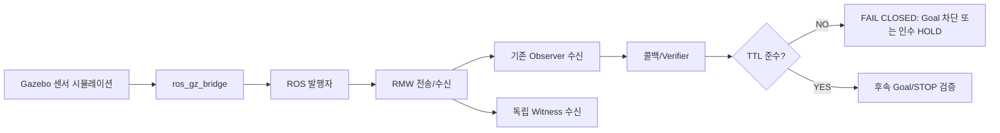

# 심화 과제 — 실패한 G07 MVP 0/2 원인 경계 분석과 수정 제안

> **교육용 실패 사례입니다.** Student 원본 `a04f9a7da8d54bbd9f944d05388792cb706adf28` + Public workflow `8e03ac0a912ca9b81bdddda70212e52e6d804389`의 실제 2026-11-21 Native Moving 0/2 실패를 분석합니다. **수정 전까지 실제 Moving Goal을 실행하지 않습니다.**

## 1. 과제 목표

1. **수치로 최초 위반을 찾습니다.** 마지막 Exception이 아니라 Cycle1 pre-Goal과 Cycle2 post-Goal의 첫 안전 상태 전이 및 타이밍 경계를 추적합니다.
2. **단위 테스트 PASS와 Moving L2 FAIL이 동시에 존재하는 이유**를 도식화합니다.
3. Observer·publisher·RMW source·Subscriber receive·callback·Clock/Odom/CM/Guard 중 **측정된 경계와 미측정된 경계**를 나눕니다.
4. AI에게 원인 가설과 **최소 변경·재현 테스트·반증 조건**을 요구합니다. 실패본과 성공본 전체 diff를 곧바로 원인으로 확정하지 않습니다.
5. 테스트 전용 자료로 RED→GREEN 검증 후, 수정 후보의 새 SHA에 대한 **실제 Native Moving CI 2/2**가 없으면 결과를 **HOLD**로 제출합니다. 강사 환경의 L3는 별도 승인입니다.

## 2. 수업에서 사용하는 버전

| 분류 | Student SHA | Public CI SHA / Run | 정확한 판정 |
|---|---|---|---|
| 실패 | `a04f9a7da8d54bbd9f944d05388792cb706adf28` | `8e03ac0a912ca9b81bdddda70212e52e6d804389` / #44914827138 | **Moving L2 0/2 FAIL**, Owner L3 NOT_RUN |
| 성공 | `f7edb2d126502eeeed58ae014adadc7a2096d41b` | `64ba0161e66126b4743b4b12a859f4a5349ae58a` / #44965035965 | **Moving L2 2/2 PASS**, Owner L3 원본 수치/Lifecycle `PASS_SCOPED` |

두 쌍은 Student 및 Public workflow의 검증 계보가 다릅니다. **성공/실패를 단일 코드 변경의 인과관계라고 단정할 수 없습니다.** FastDDS/RMW 지연의 근본 원인은 `UNDETERMINED`입니다.

## 3. 시각화: 전송 경계



**핵심:** 독립 Witness가 빠르게 수신했더라도 기존 Observer의 느린 수신/콜백 위반을 무효화하지 않습니다.

## 4. 증거 먼저 열기 (로봇 실행 없음)

```bash
python3 special_lecture/day02/scripts/verify_failed_case.py \
  --out /tmp/axia-day02-failed/evidence_check.json
python3 -m unittest discover -s special_lecture/day02/tests \
  -p 'test_*.py' -v
cat special_lecture/day02/evidence/OBSERVED_L2_0OF2_SANITIZED.json
```

위 검사기가 PASS하더라도 이는 **실패 소스와 실제 과거 실패 증거의 무결성**이 유효하다는 뜻이지, 실패본이 고쳐졌다는 뜻이 아닙니다. 원본 CI [#44914827138](https://github.com/silverbjin/axia-robot-safety-ci-public/actions/runs/44914827138)의 실패 판정은 바뀌지 않습니다.

## 5. 학생에게 제공하는 완성형 AI Master Prompt

```text
[AXIA DAY02 ADVANCED — FAILED G07 0/2 — READ ONLY FIRST]
역할: ROS 2 Jazzy, Gazebo Harmonic, Nav2/FastDDS 문제 분석가.
입력: Student 원본 a04f9a7..., Public 8e03ac..., CI Run 44914827138
      및 special_lecture/day02/evidence/OBSERVED_L2_0OF2_SANITIZED.json.
요청:
1. 소스/CI SHA와 증거 출처를 명시하고 최초 FSM 전이와 최초 TTL 위반을 찾으라.
2. source·publish·RMW received·Observer callback 시각의 구분도를 그려라.
3. pre-Goal Cycle1 / post-Goal Cycle2를 구분해 근거 있는 가설을 최대 3개 제시하라.
4. 각 가설마다 이를 부정하는 테스트와 최소 계측 변경점을 제시하라.
5. 정답을 추측하여 구현하기 전, 기존 해결 SHA f7edb2...와의
   변경 범위·CI 설정 차이를 조사하라. 다른 계보이므로 diff=인과관계로 선언하지 마라.
6. 학생 작업 브랜치의 RED 테스트 → 최소 수정 → GREEN → REFACTOR → REVIEW를 진행하라.
7. 원본 TTL 120/150/300ms, 안전 STOP, official Nav2 및 Goal 권한은 바꾸지 마라.
출력: 첫 위반 타임라인, 비교 다이어그램, 근거/가설/미측정표,
      반례 테스트, 실제 명령과 stdout, 새 커밋 SHA,
      검증 L0/L1/L2/L3 및 HOLD/ACCEPTED 판정.
금지: 실제 검증 없이 L2 성공 또는 E-Stop 안전 인증 주장;
     임의 반복 현장 실증, 진단용 source 간격으로 실제 수신 실패 은폐.
```

**왜 이런 지시가 필요한가?** AI가 최종 예외 문구만으로 근본원인을 단정하거나, 보수적 안전 한계값을 늘려 실패를 숨기는 행동을 방지하기 위해서입니다.

## 6. 6개 Unit (선택 심화 90분)

| Unit | 분 | 학생 활동 | AI 응답에서 반드시 검토할 항목 |
|---|---:|---|---|
| A01 | 10 | 정확한 실패 버전·실제 CI 증거 확인 | 0/2 vs 2/2, 같은 SHA 쌍인지 |
| A02 | 15 | 데이터 파이프라인과 시각 출처 추적 | Clock/Host monotonic/Scan Header 혼동 없는지 |
| A03 | 15 | 최초 경계 위반 분석 | Cycle1 /scan 439ms, Clock/Odom 300ms; Cycle2 /odom 362ms |
| A04 | 15 | 가설·반증 계획 | 미측정 DDS/Executor 원인 단정 금지 |
| A05 | 25 | 격리 테스트 RED→GREEN 또는 최소 수정 초안 | 안전 TTL 변경 금지, 실제 L2 미수행이면 HOLD |
| A06 | 10 | 동료 리뷰·Evidence 카드·발표 | 첫 FSM, 최초 TTL, L0/L1/L2/L3 검증 상태 명시 |

**완료 기준:** 정확한 원본 식별, 검증 가능한 첫 위반 타임라인, 최소 수정·반증 가능 테스트 계획, 실제 실행 기록과 `HOLD`/증거 기반 `PASS_SCOPED` 구분. **실제 새 SHA Moving L2 2/2 PASS를 수행하지 못한 경우 ‘문제 해결 완료’가 아닌 ‘검증 가능한 수정 후보’만 인정합니다.**

## 7. 학생 제출 템플릿

- 실패 원본 Student/Public/Run SHA:
- 성공 원본 Student/Public/Run SHA:
- Cycle1 최초 관측/첫 blocking 경계/기준:
- Cycle2 최초 FSM 전이/첫 blocking 경계/기준:
- Publisher vs RMW vs Observer vs Callback 중 어느 구간이 측정되었는가?
- 나의 가설 / 그 가설을 반증하는 관찰 / 변경 최소 범위:
- 테스트 명령 / 실제 실패(RED) 출력 / 수정(GREEN) 출력:
- 내가 수정한 작업 브랜치·SHA:
- 새 SHA 실제 Native Moving 2/2: **NOT_RUN / FAIL / PASS**:
- Owner WSL2 L3: **NOT_RUN** (교실 과제로 대체 금지):
- 최종 판단: **HOLD** 또는 **SCOPED PASS (구체적 증거 필요)**:
