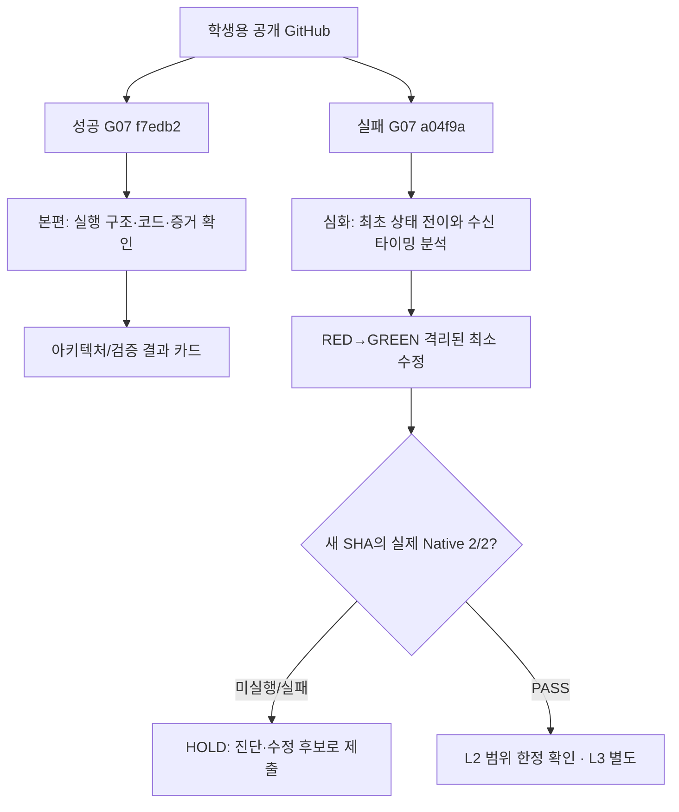

# AXIA DAY 02 — Master-first Visual Workbook v4.0 듀얼 MVP 제작 기획

**기준일:** 2026-11-26 · **정규 수업:** 180분 · **심화 선택:** 90분 · **원칙:** 성공 소스 먼저, 실패 소스는 오프라인 진단부터. 아직 40페이지 완성 워크북의 렌더링 QA는 수행하지 않았으며, 본 문서는 배포 연동형 **기획/개발 명세**입니다.

## 1. 같은 학생 저장소의 두 릴리스

| 종류 | Student 소스 SHA | 정확한 Public L2 | Owner L3 | 수업 기능 |
|---|---|---|---|---|
| 성공본 | `f7edb2d126502eeeed58ae014adadc7a2096d41b` | `64ba0161…` Run [#44965035965](https://github.com/silverbjin/axia-robot-safety-ci-public/actions/runs/44965035965), 2/2 PASS | RAW 수치·Lifecycle PASS_SCOPED | **본편 180분** 아키텍처 이해·검증 |
| 실패본 | `a04f9a7da8d54bbd9f944d05388792cb706adf28` | `8e03ac0…` Run [#44914827138](https://github.com/silverbjin/axia-robot-safety-ci-public/actions/runs/44914827138), 0/2 FAIL | NOT_RUN | **선택 90분** 최초 타이밍 위반·실패 수정 계획 |

각 버전은 독립 브랜치이며, 강의 문서가 추가된 **릴리스 HEAD SHA와 실제 Moving CI 검증 소스 SHA는 다릅니다**. 배포 검사에서 `block_B/day07/h01_runtime` 전체 Git tree가 해당 고정 소스와 동일함을 확인해야 합니다.

**주의:** 성공/실패는 Student와 Public CI의 서로 다른 SHA 쌍입니다. 단순 diff를 근본 원인이라고 단정할 수 없습니다. FastDDS/RMW 근본원인은 미입증입니다. 과거 자동 `HOLD_RAW_REVIEW_AND_VISUAL_PENDING`과 별도 L3 원본 수동 PASS_SCOPED는 각각 보존합니다.

## 2. 학생이 보게 될 두 경로



## 3. 블록과 데이터 파이프라인

```mermaid
flowchart TD
 G[Gazebo Waffle/LiDAR] --> BR[ros_gz_bridge]
 BR --> SC[/scan]
 SC --> FI[Fault Injector]
 FI --> SF[/safety/scan]
 SC --> N[Nav2 Smoother]
 N --> V[/cmd_vel_smoothed]
 V --> SU[Safety Supervisor]
 SF --> SU
 SU --> SO[/cmd_vel_supervised]
 SO --> CM[Collision Monitor]
 SF --> CM
 CM --> PRE[/cmd_vel_pre_guard]
 PRE --> GD[Base Guard]
 GD --> BASE[/cmd_vel to Base]
 BASE --> O[/odom]
 O --> EV[Verifier / evidence]
```

각 블록: **목적 → 입력 토픽·메시지 → 코드/설정 경로 → 출력 토픽 → 테스트 또는 증거** 순으로 설명합니다. 실제 정지는 `/cmd_vel=0`만이 아니라 odom ZERO dwell로 판정합니다.

## 4. 180분 본편 (완성본)

| 시각 | 분 | 교육 활동 | 학생이 얻는 결과 |
|---|---:|---|---|
| 00:00–00:15 | 15 | 결과부터 관찰, L2 2/2·Owner L3 scoped | 안전 증거 읽기 |
| 00:15–00:35 | 20 | SHA와 두 릴리스 취급, 배포 L0 | 원본 코드/배포 커밋 구분 |
| 00:35–01:00 | 25 | 4개 ROS 패키지, Node/Topic/Message 파이프라인 | 구조 다이어그램 |
| 01:00–01:20 | 20 | Master Prompt P01–P02, AI 응답 검증 | 파일/함수 근거 표 |
| 01:20–01:30 | 10 | 휴식 | — |
| 01:30–01:55 | 25 | Goal·Cancel·FSM·CM·Guard·odom 연결 | 데이터/설정 추적 |
| 01:55–02:20 | 25 | 실제 공개 L0, 기존 Native·RAW 증거 구분 | 원본 명령/출력 |
| 02:20–02:40 | 20 | AI 코드 리뷰와 증거 검수 | 오류 지적/검증 수준 |
| 02:40–02:55 | 15 | 증거 기록·교육용 Git 커밋 | 개인 SHA |
| 02:55–03:00 | 5 | 성취 발표 및 심화 안내 | Mission Complete |
| **합계** | **180** | **170분 진행 + 10분 휴식** | |

## 5. Unit별 A/B 양면 14개 (Master-first)

| Unit | A면: 잘못된 AI 응답의 예 | B면: 프롬프트 목적과 검증 | 산출물 |
|---|---|---|---|
| U00 | main=유일한 최종 실행 SHA | 두 릴리스/소스·CI 식별 | SHA 매트릭스 |
| U01 | 패키지명을 보고 기능 추정 | 실제 4개 패키지·Launch 찾기 | 역할도 |
| U02 | Node/Topic/Message 혼동 | 구독/발행 타입 추적 | 메시지 관계도 |
| U03 | Scan 경로 생략 | Gazebo→Bridge→Injector 분석 | 센서 흐름도 |
| U04 | Nav2 직접 바퀴 구동으로 설명 | Supervisor→CM→Guard 연결 | 제어 명령도 |
| U05 | cmd_vel 0=로봇 정지 | Goal UUID·odom ZERO 비교 | 정지 증거 |
| U06 | L0 PASS=Gazebo PASS | L0/L1/L2/L3 경계 고정 | 검증 표 |
| U07 | ROS Time=steady time | Host monotonic·Header 구분 | 시간축 |
| U08 | TTL 늘려도 안전하다고 제안 | CM120/Guard150/Scan300 기준 | 안전 정책 |
| U09 | Cancel 요청=Goal 종결 | 정확 UUID CANCELED(5), Nav/Loc ACK | 시퀀스 |
| U10 | 과거 0/2 실패=최신 최종상태 | 성공 이력·증거·SHA 계보 | 이력 |
| U11 | AI가 쓴 경로가 실존한다고 가정 | 파일·함수·diff 실물 검수 | 리뷰 |
| U12 | 예시 출력=실제 실행 | 원본 stdout, rc, 미검증 구별 | 증거 |
| U13 | Git commit=안전 인증 | 승인/인수 범위·30초 발표 | 성과 카드 |

**각 Unit B면 필수:** 전체 복사 프롬프트, 설계 이유, 실행 전 입력, 예상 출력, 학생의 실제 출력, AI 응답 확인 체크 3개, 오류 재질문, 실습 마무리. **A면:** AI 오답과 원인 추리, 학생 메모. 현재 v4는 이 구조의 상세 제작 기획이며 28개 완성 PDF 페이지가 만들어졌다고 주장하지 않습니다.

## 6. A01~A06 심화 워크북 90분 (실패본)

| Unit | 분 | 과제 | AI 응답 QA |
|---|---:|---|---|
| A01 | 10 | `a04f9a7d`/Public `8e03ac0` 원본 CI·PR 확인 | 실제 0/2인지 |
| A02 | 15 | Gazebo→bridge→publisher→RMW→Observer 데이터·시간 경계 | Source/Receive/Callback 혼동 여부 |
| A03 | 15 | Cycle1 PRE-GOAL /scan 439.012ms, Clock 335.394ms, Odom 374.025ms; Cycle2 POST-GOAL /odom 362.100ms, CM preGuard 379.730ms | 최초 위반·상태 구분 |
| A04 | 15 | 가설 최대 3개와 각각의 반증 테스트 | DDS/Executor 근본원인 단정 금지 |
| A05 | 25 | 실패본 파생 개인 브랜치에서 RED→최소 변경→GREEN→REFACTOR→REVIEW | TTL 완화 금지, 검증한 코드 경계만 PASS |
| A06 | 10 | 파일·명령·stdout·Git SHA·L0/L1/L2/L3를 제출 | 미검증 L2는 HOLD |

**성취 기준:** 새로운 실제 Gazebo L2 2/2를 실행하지 않아도 '실패를 고쳤다'고 말하지 않으며, 재현 가능한 첫 위반 타임라인과 반증 가능한 수정 후보를 갖추면 심화 학습 성과로 인정합니다.

## 7. 두 릴리스 한 번에 확인하는 명령

```bash
cd ~
git clone --single-branch --branch release/day02-g07-accepted-20261126 \
  https://github.com/silverbjin/axia-robot-safety-student.git axia-day02-success
cd ~/axia-day02-success
python3 special_lecture/day02/scripts/verify_release.py
bash special_lecture/day02/scripts/prepare_dual_mvp.sh "$HOME/axia-day02-failed"
python3 "$HOME/axia-day02-failed/special_lecture/day02/scripts/verify_failed_case.py"
```

이 실행기는 실패 릴리스 REF가 지정 SHA와 다르거나 기존 디렉터리가 있으면 fail closed, 정상 런타임 변경 금지, 자동 Goal/Gazebo 실행 없음. 실제 WSL2에서 수행되었다고 주장하지 않습니다.

## 8. 프롬프트 설계 이유와 AI 검토 8문항

프롬프트는 코드 생성 주문이 아니라 **변경할 범위, 증거 출처, 수행 명령, 인수 수준을 구속하는 사양**입니다. AI 응답은 ① 두 SHA 쌍 ② 파일/함수/토픽 실존 ③ 시간 단위/ROS vs host ④ 최초 안전 상태/타이밍 위반 ⑤ publisher·RMW·Observer 분리 ⑥ 실제 stdout·rc ⑦ 새 CI 미수행이면 HOLD ⑧ SW STOP != E-Stop 순으로 확인합니다.

수정 요청 예: "당신의 근본원인 주장 중 실제 증거로 입증되지 않은 것은 가설로 되돌리고 각 가설의 반증 테스트, 첫 위반, 변경 금지 TTL, 새 SHA 검증 L0–L3를 다시 제시하십시오."

## 9. 배포·검수 계약

두 원본 런타임 Git subtree가 성공 `f7edb2d126502eeeed58ae014adadc7a2096d41b` / 실패 `a04f9a7da8d54bbd9f944d05388792cb706adf28`와 각각 정확 일치, 핵심 8개 Blob 해시 고정, 실제 실패 원본 수치 오염 금지, 숨김 강사 정답·원본 rosbag 공개 금지, 독립 **Public CI L0 GREEN 후 브랜치 배포**, 새 실제 Moving L2/L3를 수행하지 않았다면 원본 증거를 **REUSED**로 기록합니다. `main` 병합은 명시적 사용자 승인 이전에 금지합니다.
