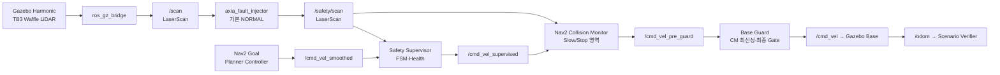
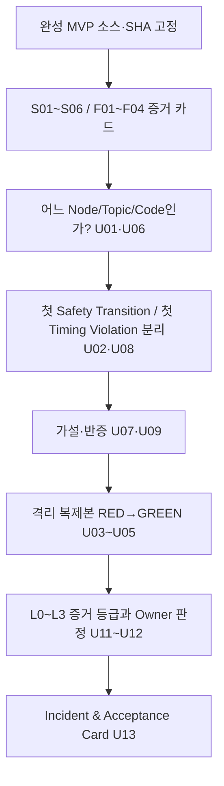

# AXIA DAY 3 — 완성 G07 MVP 시나리오 사용·강사 데모·학생 증거 분석 가이드 v1.0

> 대상: WSL2 Ubuntu 24.04 / ROS 2 Jazzy / Gazebo Harmonic / TurtleBot3 Waffle / Nav2 / 안전 감독 계층.  
> 목적: 이미 완성된 MVP를 새로 개발하지 않고 **코드의 입력·처리·출력, 실제 성공·실패 증거, 개발→통합→인수 프롬프트**를 배우는 DAY 3(180분) 수업 자료.  
> **실행 등급:** 학생 필수 = 과거 원본 보고서의 **정적 증거 카드 리플레이(L0)**, 강사 선택 = 기존 실제 Gazebo NO_GOAL, 강사 별도 승인 = 기존 Moving Goal. 신규 Gazebo/L2·Owner L3는 이 문서 제작 중 **NOT_RUN**.

## 0. 먼저 결과 보기: 로봇이 움직이는 것을 무엇으로 증명할까요?

이 MVP로 수업에서 다룰 대표 장면은 **준비 → CLEAR → SLOW → STOP → 정확한 Goal UUID 취소 → 실제 odom 정지 유지 → 종료**입니다. 학생에게 로봇의 그림만 보여주지 말고, Scan 거리·CM 출력·Guard 출력·odom·Nav2 Action 결과·종료 ACK를 단계별로 추적하도록 지도합니다.

성공 증거는 2026-11-22 강사 WSL2 실행의 공개 사후 보고서 인용이고, 실패 증거는 **다른 실행·다른 SHA**인 2026-11-21 공개 Native L2 실패 이력입니다. 서로 섞어 하나의 시간축으로 계산해서는 안 됩니다.

| 출처 | 정확한 기준 | 기존 판정 | 실습에서의 의미 |
|---|---|---|---|
| 학생용 전체 소스 배포 | `release/day02-dual-mvp-full-source-build-20261126` · `96be43164fab3f15025edd59279bcfd50b6232cd` | 성공·실패 양쪽 소스 포함 | 원본 구조와 SHA 고정 |
| 성공 소스 | `f7edb2d126502eeeed58ae014adadc7a2096d41b` | Native Moving L2 **2/2 PASS**, Run [#44965035965](https://github.com/silverbjin/axia-robot-safety-ci-public/actions/runs/44965035965) | 이미 완료된 범위의 실증 |
| 기존 Owner 한 세션 | [2026-11-22 사후 원본 검수](https://github.com/silverbjin/axia-robot-safety-ci-public/blob/c2c4f66c532be2a41855239860b9a9f5d60c4586/docs/operations/AXIA_G07_OWNER_WSL2_L3_POSTRUN_RAW_EVIDENCE_REVIEW_20261122_KO.md) | 수치·Lifecycle `PASS_SCOPED`, 원본 자동 `HOLD_RAW_REVIEW_AND_VISUAL_PENDING` 보존 | 영상 콘텐츠 독립 검수는 안 됨 |
| 실패 소스 | `a04f9a7da8d54bbd9f944d05388792cb706adf28` | Native Moving L2 **0/2 FAIL**, Run [#44914827138](https://github.com/silverbjin/axia-robot-safety-ci-public/actions/runs/44914827138) | 재현 가능한 디버깅 과제; Owner L3 `NOT_RUN` |
| 교육용 스냅샷 | [DAY 2 공개 카드 원본](https://github.com/silverbjin/axia-robot-safety-student/blob/f43df3132c8c1dac29f7c980274cd85bcdda02fc/special_lecture/day02/scenarios/PROVEN_G07_SCENARIO_SNAPSHOT_20261122.json) | `PUBLIC_REPORT_EXCERPT_NOT_RAW_BAG` | 정적 설명용, rosbag·영상 아님 |

**시연은 인증 E-Stop이 아닙니다.** 소프트웨어의 STOP과 정식 하드웨어 안전 인증을 혼동하지 않도록 명시합니다.

## 1. 실제 G07의 데이터 파이프라인



> 이 그림은 공개 DAY 2 시나리오 가이드의 설명용 경로입니다. 정확한 최종 topic remap·QoS·launch 설정은 **해당 코드 SHA의** `configs/`, `ros2_ws/src/axia_safety_bringup/launch/`에서 반드시 재확인하십시오. 시뮬레이션 실행 없이 실제 ROS graph를 관측했다고 보고하지 않습니다.

| 블록 | 받는 데이터 | 처리 | 출력·증거 / 실제 파일 |
|---|---|---|---|
| Gazebo + Bridge | 물리 시뮬레이션 센서 | `LaserScan` 전달 | `/scan`; 공식 의존성 |
| Fault Injector | `/scan` | NORMAL 통과, 제한된 실습용 drop/stale/future 모드 | `/safety/scan`; `accepted/runtime/ros2_ws/src/axia_fault_injector/axia_fault_injector/fault_injector_node.py` |
| Supervisor | Scan·Nav2 속도·Health | 상태·제어 정책 | `/cmd_vel_supervised`; `.../axia_safety_supervisor/p2_supervisor_node.py` |
| Collision Monitor | Scan·속도 | 공간별 감속/정지 | `/cmd_vel_pre_guard`; `configs/p2_collision_monitor_zones.yaml` |
| Base Guard | CM 후단 속도·유효 시각 | 150ms CM TTL 등 최종 명령 게이트 | `/cmd_vel`; `.../p2_base_guard_node.py`, `.../p2_base_guard_policy.py` |
| Verifier | Scan, Goal, odom, lifecycle, process log | 안전 계약 판정 | `accepted/runtime/tools/p2_g07_ci_moving_goal_oracle.py`, `.../p2_g07_ordered_shutdown.py` |

`/cmd_vel` 0은 **명령**이고 `/odom` 0이 일정 시간 유지되는 것은 **물리 측정 증거**입니다. 정상 주행과 안전 정지 판단 모두 확인해야 합니다.

## 2. 학생·강사의 시나리오 선택표

| ID | 보여줄 장면 | 실행 모드 | 증거와 질문 | 워크북 연결 |
|---|---|---|---|---|
| S01 준비 | LiDAR→Bridge→Scan→Safety 채널 | 학생 카드 / 강사 NO_GOAL 선택 | `/scan`과 `/safety/scan`이 다른 역할을 갖는 이유 | U00~U01, U06 |
| S02 CLEAR | 실제 이동 가능한 전방 공간 | 성공 카드 | 최종 Guard 속도가 CM 속도와 다른 이유는? | U01, U10 |
| S03 SLOW | 장애물 접근 감속 | 성공 카드 | 설정 ratio와 관측 속도 비율을 구분할 수 있는가? | U06~U10 |
| S04 STOP | 제어 속도 0 | 성공 카드 | odom의 정지 유지까지 확인했는가? | U08, U10 |
| S05 취소 | 정확한 Goal UUID가 `CANCELED(5)` | 성공 카드 | Goal cancel ACK·terminal·odom ZERO는 서로 다른 증거 | U11~U12 |
| S06 종료 | Nav ACK→Loc ACK→CM exit0 | 성공 카드 | ACK 하나만으로 clean exit를 주장할 수 있는가? | U11~U13 |
| F01 실패 예고 | PRE_GOAL `/scan` 수신 공백 | 실패 카드 | Goal 전 최초 위반을 찾았는가? | U07~U09 |
| F02/F03 | POST_GOAL Odom·CM 경계 | 실패 카드 | 첫 상태 전이와 첫 TTL 위반을 따로 썼는가? | U08~U10 |
| F04 | source·독립 RMW·기존 구독자 RMW | 실패 카드 | 다른 Subscriber 수신치를 동일 경계로 가정하지 않았는가? | U07~U10 |
| X01 선택 | Injector DROP/STALE/FUTURE 기능의 코드 읽기 | 읽기 전용 권장 | 실제 Fault 호출은 강사 승인된 격리된 Gazebo에서만 | U01, U03 |

### 성공 시나리오 S01~S06: 과거 Owner 한 실행의 실제 숫자

| 단계 | 앞쪽 거리 | CM 속도 | 최종 Guard 속도 | 학생이 판독할 사실 |
|---|---:|---:|---:|---|
| S02 CLEAR | 2.048107m | 0.062925m/s | 0.037684m/s | 로봇 움직임 후보. 실제 이동은 odom으로 확인 |
| S03 SLOW | 0.674758m | 0.004810m/s | 0.003422m/s | **아주 작은 속도**라 GUI에서 감속이 눈에 잘 안 띌 수 있음 |
| S04 STOP | 0.396788m | 0m/s | 0m/s | 출력 정지. `/odom` ZERO 유지 1.026194649초 별도 증거 |
| S05 취소 | — | — | — | 같은 Goal UUID `CANCELED(5)`/cancel ACK, 총 이동 0.129946523m |
| S06 종료 | — | — | — | Nav/Loc ACK, CM exit0, 전체 21개 프로세스 clean exit |

동일 Owner 실행의 최대 수신·Guard 지표: Scan 215.082877ms(기준 300ms), Clock 95.138822ms(300ms), Odom 149.593842ms(300ms), CM `/cmd_vel_pre_guard` 71.460029ms(120ms), Guard 내부 CM age 49.279328ms(150ms). **이번 세션 Contact 0**은 충돌이 없었다는 의미이며 Positive Contact calibration을 이번 세션에서 재실행한 것은 아닙니다.

### 실패 시나리오 F01~F04: 성공본과 다른 Run ID

| 실패 증거 | 과거 실패 실행 숫자 | 판단 |
|---|---|---|
| F01 Cycle1 PRE_GOAL | `/scan` 439.011892ms, `/clock` 335.393855ms, `/odom` 374.025229ms | Goal 발행 전에 이미 수신 공백; 300ms 초과 |
| F02 Cycle2 POST_GOAL | 최초 상태 전이 `BOOT_SAFE→NORMAL`, 최초 blocking `/odom` 362.100229ms | 상태 전이와 최초 TTL 위반은 독립 사건 |
| F03 Cycle2 전달 | `/cmd_vel_pre_guard` 379.730024ms | 120ms 기준 초과 |
| F04 Cycle2 다중 관측 | CM source 53.837048ms, 독립 수신 54.116537ms, 기존 Subscriber RMW 수신 375.941379ms | **같은 세션 내 서로 다른 계층** 관측, 근본 원인은 여전히 `UNDETERMINED` |

> S02~S06의 Owner 숫자와 F01~F04의 Public CI 숫자는 서로 다른 실행입니다. 가짜 공통 타임라인을 만들지 마십시오. 독립 RMW witness와 실제 Guard 내부 수신도 동일한 토픽 수신자를 뜻하지 않습니다.

## 3. 학생용 실행 ① — 공개 소스 + 정적 리플레이 (필수)

학생의 기본 실습은 **ROS/Gazebo 설치 없이 Python 3와 Git만으로 가능**합니다. 아래 스크립트는 기존 DAY 2 리플레이를 정확한 Commit/Blob SHA로 검증하고 호출합니다. 직접 노드를 실행하거나 Goal을 보내지 않습니다.

```bash
# DAY3 실습 브랜치의 교육용 문서/스크립트 내려받기 (기존 같은 이름 폴더가 없어야 합니다)
cd "$HOME"
git clone --single-branch \
  --branch feat/day03-g07-scenario-use-guide-20261126 \
  https://github.com/silverbjin/axia-robot-safety-student.git axia-day03-class
cd "$HOME/axia-day03-class"

# 1) 환경·스크립트 검사: 네트워크 접속/ROS/Gazebo/Goal 없음
bash special_lecture/day03_mvp_workbook/scripts/day03_g07_scenario_once.sh --doctor

# 2) 성공본 6단계, 실패본 4단계 카드
bash special_lecture/day03_mvp_workbook/scripts/day03_g07_scenario_once.sh --success
bash special_lecture/day03_mvp_workbook/scripts/day03_g07_scenario_once.sh --failed

# 3) 두 버전 증거를 분리해 표시하고 학생 보고용 JSON 생성
mkdir -p "$HOME/axia-day03-evidence"
bash special_lecture/day03_mvp_workbook/scripts/day03_g07_scenario_once.sh \
  --compare --json-out "$HOME/axia-day03-evidence/day03_compare_$(date -u +%Y%m%dT%H%M%SZ).json"
```

**다운로드 방식:** 위 최초 `--success/--failed/--compare` 요청 시 스크립트가 DAY 2 시나리오 공개 브랜치 `feat/day02-g07-scenario-demo-20261126`를 분리된 캐시에 Clone합니다. Git HEAD가 `f43df3132c8c1dac29f7c980274cd85bcdda02fc`와 다르거나 원본 Python/JSON Git Blob SHA가 다르면 **HOLD로 중단**합니다. 기존 캐시가 있으면 덮어쓰거나 삭제하지 않습니다.

**예상 출력 일부(이전 공개 보고서의 정적 카드, 이번 현장 실측 아님):**

```text
DAY3_SCENARIO_UPSTREAM_PIN_OK=f43df3132c8c1dac29f7c980274cd85bcdda02fc case=compare
DAY3_SCENARIO_SCOPE=HISTORIC_EVIDENCE_REPLAY_L0_ONLY NEW_L2_L3=NOT_RUN
HISTORICAL_EVIDENCE_REPLAY_NO_ROS_NO_GOAL
NEW_L2_L3_NOT_RUN  CERTIFIED_ESTOP=false
[ACCEPTED G07 / HISTORIC OWNER L3 RAW PASS_SCOPED]
S02 CLEAR: 전방 2.048107m / CM 0.062925m/s / Guard 최종 0.037684m/s
...
[REJECTED G07 / HISTORIC PUBLIC NATIVE MOVING L2 0/2 FAIL]
F01 Cycle1 PRE_GOAL: /scan 439.012ms >300 ...
```

확인할 JSON 필드: `verification_level = HISTORIC_EVIDENCE_REPLAY_L0_ONLY`, `new_ros_gazebo_run = false`, `new_l2_l3_acceptance = false`, `certified_estop = false`. 기존 파일이 존재하면 덮어쓰기를 거부합니다.

### 학생용 실행 ② — 네 패키지의 실제 소스 직접 빌드 (선택)

성공/실패 버전의 **소스가 모두 공개된 별도 기준 브랜치**를 그대로 활용합니다. 이것은 새 Gazebo 실행이 아니라 ROS 2 Jazzy `ament_python` 패키지 빌드입니다.

```bash
cd "$HOME"
git clone --single-branch --branch release/day02-dual-mvp-full-source-build-20261126 \
  https://github.com/silverbjin/axia-robot-safety-student.git axia-day03-build-src
cd "$HOME/axia-day03-build-src"
git checkout --detach 96be43164fab3f15025edd59279bcfd50b6232cd
python3 special_lecture/day02_mvp_sources/scripts/verify_dual_source.py
bash special_lecture/day02_mvp_sources/scripts/build_dual_mvp.sh --doctor
bash special_lecture/day02_mvp_sources/scripts/build_dual_mvp.sh \
  --accepted --out "$HOME/axia-day03-build-accepted"
```

빌드 시작 전 ROS Jazzy, `colcon`, `ament_python` 등이 필요한 것은 `--doctor`가 확인합니다. 출력 폴더가 기존에 존재하면 `--accepted`는 이를 덮어쓰지 않습니다. `colcon build PASS`는 Native Moving L2 PASS가 아닙니다.

## 4. 강사용 선택 시연 (학생 자동 실행 금지)

### 옵션 A: 실제 Gazebo/RViz를 띄우는 NO_GOAL 구조 시연

완성 MVP 공개 소스의 기존 `scripts/d07_h01_gui_no_goal_once.sh`를 **새로 작성하지 않고 재사용**합니다. 이 데모는 현장 주행 Goal을 발행하지 않는 별개 실험입니다. 소스 위치는 `~/axia-day03-class/special_lecture/day02_mvp_sources/accepted/runtime`입니다.

```bash
cd "$HOME/axia-day03-class/special_lecture/day02_mvp_sources/accepted/runtime"
bash scripts/d07_h01_gui_no_goal_once.sh --self-check
bash scripts/d07_h01_gui_no_goal_once.sh --doctor
# 강사가 환경을 검토하고 실제 Gazebo와 RViz가 필요할 때만 명시적 선택:
# bash scripts/d07_h01_gui_no_goal_once.sh --run
```

`--self-check`는 정적 검사, `--doctor`는 설치·명령·패키지 검사, `--run`은 실제 Gazebo/WSLg 실행입니다. Gazebo를 실행하지 않은 경우 성공했다고 보고하지 않습니다. GUI 불안정성은 시나리오 안전 게이트와 별도입니다.

### 옵션 B: 실제 CLEAR→SLOW→STOP Moving Goal 데모 (강사 전용)

새 Moving 엔진을 제작하거나 필수 학생 과제에 추가하지 않습니다. 원본 공개 CI Runner로만 진행하고 **실제 실행은 강사의 명시적 TTY 동의**를 요구합니다.

```bash
PIN=c2c4f66c532be2a41855239860b9a9f5d60c4586
curl -fsSLo "$HOME/axia_g07_owner_once.sh" \
  "https://raw.githubusercontent.com/silverbjin/axia-robot-safety-ci-public/$PIN/scripts/axia_g07_stabilization_wsl2_final_once.sh"
bash "$HOME/axia_g07_owner_once.sh" --self-check
bash "$HOME/axia_g07_owner_once.sh" --ci-check
# CI 두 개 native cycle PASS + 강사 승인 + 실제 환경 사전 점검 후만 실행:
# bash "$HOME/axia_g07_owner_once.sh" --run
```

이 `--run` 명령을 학생용 원샷에 포함하지 마십시오. 실패하면 최초 안전 상태 전이와 최초 타이밍 위반을 원본에 기록하고, 현장 재실행을 반복하기 전에 재현 가능한 부분을 CI 회귀로 먼저 편입해야 합니다.

## 5. DAY 3에서 프롬프트로 시나리오를 학습하는 방법



**프롬프트 D — 개발:** “제공된 `p2_g07_health_first_boundary.py`와 공개 테스트를 읽고 최초 readiness blocker/상태 전이의 입력·출력 계약을 기술하십시오. 원본을 변경하지 말고 별도 학습 복제본에서 최소 반례를 먼저 RED로 재현한 뒤 GREEN과 코드 diff·테스트 stdout/exit code를 제출하십시오.” **검토할 응답:** 실제 함수 경로·계약 언급 여부, RED가 의도한 사유로 실패했는지, 원본 안전 정책 불변 여부.

**프롬프트 I — 통합:** “성공 Owner와 실패 Native Run의 기록을 섞지 말고 `/scan`과 `/safety/scan` 및 CM source, 기존 RMW, 독립 observer 간격을 같은 Run 안에서 구분하십시오. `first_safety_transition`·`first_timing_violation`을 별도 필드로 작성하고 가설·반증 관측을 각각 제시하십시오.” **검토할 응답:** 다른 시간축의 절댓값을 빼지 않았는지, FastDDS/Executor를 근본 원인으로 단정하지 않았는지.

**프롬프트 A — 인수:** “실제 소스 SHA와 Run ID별로 Clear/Slow/Stop, 같은 Goal UUID terminal 5, odom ZERO≥1초, Nav/Loc ACK, CM exit0, Scan 300ms/CM 120ms/Guard 150ms를 독립 Gate로 판정하십시오. 과거 L2, Owner `PASS_SCOPED`와 원본 자동 HOLD를 모두 명시하고, 이번 실습은 신규 L2/L3 `NOT_RUN`으로 기록하십시오.” **검토할 응답:** CM exit0이 단순 ACK에서 추론되지 않았는지, 신규 인수 PASS를 날조하지 않았는지.

학생 최종 산출물에는 반드시 `(1) 원본 SHA/Run, (2) 시나리오 단계별 데이터 흐름, (3) 첫 상태 전이/첫 TTL 위반, (4) 가설·반증, (5) 실제 수행한 명령과 출력·exit code, (6) PASS_SCOPED/HOLD/NOT_RUN, (7) 미검증 범위, (8) 본인 Git 커밋`을 제출하도록 안내합니다.

## 6. 강사용 20분 데모 진행 대본

- **0~3분:** 완성 MVP 코드와 과거 성공 L2 2/2, 실패 L2 0/2를 서로 다른 SHA로 소개합니다. 질문: “둘 다 빌드되는데 시연 결과는 왜 다를까요?”
- **3~8분:** 정적 카드 `--success`를 사용해 S01~S04의 Scan·CM·Guard 출력과 `/odom`의 역할을 보여줍니다. SLOW는 화면보다 숫자 이해가 중요합니다.
- **8~12분:** S05와 S06에서 정확 UUID의 `CANCELED(5)`, 실제 ZERO dwell, 두 Lifecycle ACK와 CM exit0을 구분합니다.
- **12~17분:** `--failed` 또는 `--compare`의 F01~F04를 펼치고 **Goal 발행 전 Scan 수신 간격 초과** 및 서로 다른 수신자 계층을 비교합니다.
- **17~20분:** U07~U13 프롬프트 평가표와 Incident Card로 인계합니다. “AI가 근본 원인을 확정하면 어떤 근거를 요구해야 할까요?”

이 슬롯은 신판 52장 워크북의 **S03~S13 소스·구조 부분, S26~S35 통합 분석, S36~S47 인수 카드**에 배치할 수 있습니다. 새로운 별도 20분 강의를 추가하지 않습니다.

## 7. 자주 발생하는 문제와 수정 금지 항목

| 증상 | 확인할 지점 | 해서는 안 되는 일 |
|---|---|---|
| `--doctor` FAIL | Git/Python 설치·Shell 구문 | 환경 미확인 상태에서 Gazebo 실행 |
| `CLONE_FAILED_HOLD` | GitHub 네트워크, Repo URL, 브랜치 | 검증되지 않은 최신 `main` 파일로 대체 |
| `SHA_OR_ORIGIN_DRIFT_HOLD` | 캐시 HEAD·remote URL | 원본 PIN 검사를 우회하거나 강제 checkout |
| `SOURCE_BLOB_DRIFT_HOLD` | Python/JSON blob SHA | 과거 실측값을 수정해 PASS 조작 |
| 비교 JSON 출력 실패 | 기존 파일 존재 여부, 쓰기 권한 | 기존 증거 파일 덮어쓰기 |
| `/scan`만 정상, `/safety/scan` 지연 | Injector relay·구독자·QoS/Callback | TTL 300ms를 완화하여 합격 처리 |
| Nav/Loc ACK는 있지만 CM exit 미확인 | 종료 Audit·launch.log | ACK 하나로 전 프로세스 정상 종료 주장 |
| 학생 코드만 GREEN | CI L0·ROS 빌드 L1·Gazebo L2·Owner L3 각각 | `GREEN = L3 PASS` 처리 |

**안전 범위:** 시뮬레이션용 Software STOP ≠ 인증 E-Stop. ROS/Gazebo와 WSL2 실제 실행을 하지 않았다면 `NOT_RUN`. 수업 공개 자료에 원본 Owner rosbag, 비밀 경로, 강사 정답/Hidden Test를 포함하지 않습니다. GitHub `main` 병합은 별도 승인 전 수행하지 않습니다.
