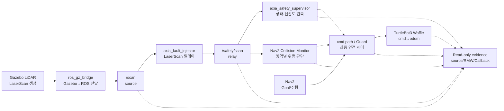
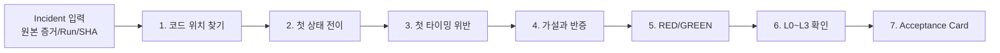

# AXIA DAY 3 — 완성 G07 MVP 기반 AI Native 오류 해결 워크북 제작 계획 v3.0
> 상태: WORKBOOK_PLAN / STUDENT RELEASE CANDIDATE — not completed workbook, not a new L2/L3 acceptance.
> 작성일: 2026-11-26
> 목표: 개발 → 통합 → 인수의 실제 오류를 코드·로그·테스트·CI 근거와 **프롬프트 설계**로 해결한다.
> 180분 수업 / 학생 실습은 이미 완성된 공개 MVP에서 출발 / 새 로봇 제어 기능 개발 금지.

## 0. 핵심 변경과 소스 고정
DAY1 SPEC → DAY2 CODE를 토대로 DAY3은 EVIDENCE → ACCEPTANCE로 이어진다.
기존 DAY3 v2의 합성 JSONL/교육용 단독 분석기는 '개념 맛보기' 부록으로만 남기고, 본 실습은 **공개 학생 저장소에 배포된 실제 G07 런타임**을 사용한다.

- 리포지토리: silverbjin/axia-robot-safety-student
- 재사용 릴리스: `release/day02-dual-mvp-full-source-build-20261126`
- 재사용 릴리스 커밋: `96be43164fab3f15025edd59279bcfd50b6232cd`
- 출처 선언: `special_lecture/day02_mvp_sources/DUAL_SOURCE_MANIFEST.json`
- 완성본: `accepted/runtime/` (186개 파일), 원본 Student SHA `f7edb2d126502eeeed58ae014adadc7a2096d41b`
- 실패 이력본: `failed/runtime/` (187개 파일), 원본 Student SHA `a04f9a7da8d54bbd9f944d05388792cb706adf28`
- 과거 공개 Native Moving L2: 완성본 #44965035965 2/2 PASS, 실패 이력본 #44914827138 0/2 FAIL.
- 완성본 11/22 Owner L3: `PASS_SCOPED`; 원래 자동 판정 `HOLD_RAW_REVIEW_AND_VISUAL_PENDING`도 함께 보존.
- ROS 2 패키지 4개: `axia_fault_injector`, `axia_safety_bringup`, `axia_safety_supervisor`, `axia_scenario_verifier`.
- 이 두 버전의 `ros2_ws/src` 트리는 동일하다. **빌드 성공과 Moving L2 성공의 차이**가 주요 학습 소재다.
- 이번 DAY3 개정에서는 런타임 소스를 다시 복사/수정/배포하지 않는다. **이미 배포된 동일 Git Tree를 참조**한다.
- `main` 병합은 별도 사용자 승인 전 수행하지 않는다. 강사 정답/Hidden Test/원본 rosbag/토큰은 공개하지 않는다.

## 1. 새 강의의 성공 정의
초심자가 실습을 마치면 다음 다섯 문장을 실제 파일과 증거로 설명할 수 있어야 한다.
1. 어느 파일, 어느 패키지, 어느 node가 어떤 메시지를 읽고 어떤 결과를 내는지 설명한다.
2. AI에게 원인을 '알려 달라'고만 하지 않고 **관측 사실·가설·반증·최소 수정·검증 범위**를 요청한다.
3. 오류를 **첫 상태 전이**(`first_safety_transition`) 및 **첫 타이밍 위반**(`first_timing_violation`)으로 분리하여 찾는다.
4. `RED → GREEN → REFACTOR → REVIEW → COMMIT` 증거를 같은 fixture·SHA·시간축으로 연결한다.
5. L0/L1 테스트의 성공과 실제 Gazebo L2 및 Owner WSL2 L3의 인수를 구분한다.

최종 성과물: 개인 Git 커밋 1개 + Development/Integration/Acceptance Incident Card 1장 + 90초 기술 브리핑.
실제 미재현 항목은 `NOT_RUN` 또는 `INCONCLUSIVE`이며 인수 미달은 `HOLD`.

## 2. 실제 MVP 개념 아키텍처 (실제 토픽 연결은 launch/설정에서 확인)

이 그림은 설명용 **논리적 관계**다. 특정 `cmd_vel` 토픽 체인, QoS, 실제 연결은 `configs/` 및 `ros2_ws/src/axia_safety_bringup/launch/`에서 실습 중 확인한다. Diagram을 소스 코드의 확인 전 토픽 사실로 확대하지 않는다.

실제 코드 길잡이:
- `accepted/runtime/ros2_ws/src/axia_fault_injector/axia_fault_injector/fault_injector_node.py`: Scan 입력과 출력, 기본 비활성 Fault 서비스, status Publisher
- `accepted/runtime/ros2_ws/src/axia_safety_supervisor/axia_safety_supervisor/p2_supervisor_node.py`: Supervisor 런타임
- `accepted/runtime/ros2_ws/src/axia_safety_supervisor/axia_safety_supervisor/p2_base_guard_node.py`: Guard 런타임
- `accepted/runtime/tools/p2_g07_health_first_boundary.py` + `test_g07_health_first_boundary.py`: 최초 readiness/blocker/state transition
- `accepted/runtime/tools/p2_g07_scan_rmw_first_pair.py` + `test_g07_scan_rmw_first_pair.py`: 동일 publication의 source/RMW/Observer 비교
- `accepted/runtime/tools/p2_g07_ci_moving_goal_oracle.py`: 최초 delivery 위반과 Guard 지연의 진단 분리
- `accepted/runtime/tools/p2_g07_ordered_shutdown.py` + `test_g07_context_graph_shutdown.py`: Nav/Loc ACK와 종료 경계
- `accepted/runtime/docs/AXIA_G07_TASK04_DEMO_BASELINE_20261119_KO.md`: 교육용 기준선과 검증 한계

## 3. 180분 운영: 개발/통합/인수 3단계 미션
| 시간 | 교육 목표 | 학생이 확인할 성과 |
|---|---|---|
| 00~15분 | **완성된 MVP 결과 먼저**: 실제 2/2 PASS와 역사적 0/2 FAIL 제시, 문제 문장 만들기 | 초깃값 Incident Card |
| 15~40분 | Source/Build/Graph 읽기: SHA·파일·토픽·4패키지 | `--verify` 로그, 블록별 Input/Process/Output |
| 40~75분 | **미션 D — 개발 단계**: 최초 상태 전이 분석, 증거 기준 RED→GREEN 최소 수정 | 개인 실습용 코드/회귀 테스트 |
| 75~85분 | 휴식 및 질문 정리 | RED/GREEN 체크 |
| 85~130분 | **미션 I — 통합 단계**: Scan source/RMW/Callback, /scan vs /safety/scan, CM→Guard 경계 | 원인 가설·반증·추가 계측표 |
| 130~165분 | **미션 A — 인수 단계**: Goal UUID, Nav/Loc ACK, CM exit, 타이밍·L0~L3 | 증거 Manifest와 PASS/HOLD/NOT_RUN |
| 165~180분 | 90초 브리핑/회고: AI 답변 QA와 재발 방지 | 최종 Incident & Acceptance Card |

필수 학생 실습은 Git SHA 확인, L0 읽기전용 계약, 진단 모듈의 개인 복제본 테스트, 증거 판정에 한정한다. 실시간 Gazebo Moving Goal은 교사 준비 영상/과거 동일 Run evidence로 학습하며 필수 학생 실행은 아니다.

## 4. Master-first: 처음부터 완성형 프롬프트 공개
`MASTER_PROMPT_DAY3_MVP_KO.txt`를 시작 단계에서 **전문 그대로** 공개한다. 학생은 먼저 출력 계약을 살피고, U00~U13에서 왜 그 지시가 필요한지 역분해한다.

| Unit | MASTER 지시 | 대상 실제 코드/근거 | 학생이 볼 결과 |
|---|---|---|---|
| U00 | 출처·SHA·Run ID·L0~L3 고정 | DUAL_SOURCE_MANIFEST.json | 증거 혼합 방지 |
| U01 | 소스·패키지·토픽 그래프 | four package.xml, fault_injector_node.py | 입력/처리/출력 도표 |
| U02 | 개발 단계의 첫 관측 사실 찾기 | p2_g07_health_first_boundary.py | 최초 blocker/상태 전이 |
| U03 | 개발 가설과 반례·테스트 선정 | test_g07_health_first_boundary.py | 먼저 실패해야 할 계약 |
| U04 | 격리 복제본 RED→최소 GREEN | 교육용 진단 모듈·테스트 복제 | 실제 stdout/exit code |
| U05 | REFACTOR/REVIEW/COMMIT | diff, git status, tests | 개인 커밋 |
| U06 | 통합 그래프 경계 | /scan, /safety/scan, launch/config | 송·수신 노드 분리 |
| U07 | 서로 다른 시간축 및 주기 구분 | p2_g07_scan_rmw_first_pair.py | source_gap / received_gap / observer_gap |
| U08 | 첫 타이밍 위반과 상태 전이 | p2_g07_ci_moving_goal_oracle.py | first_timing_violation 별도 |
| U09 | 원인 후보 반증 | test_g07_scan_rmw_first_pair.py | source/RMW/Callback 가설표 |
| U10 | CM→Guard 주변 경계 검토 | oracle, Guard, supervisor | 개별 PASS ≠ 전체 PASS |
| U11 | 인수 시퀀스 | p2_g07_ordered_shutdown.py | UUID terminal→Nav ACK→Loc ACK→CM exit |
| U12 | L0/L1/L2/L3와 Evidence Manifest | 기존 CI #44965035965/#44914827138 | 실제·과거·미검증 구분 |
| U13 | Incident Card+90초 브리핑 | 모든 증거 | 최종 HOLD/PASS_SCOPED 판정 |

**수업 핵심 U02~U05/U06~U10/U11~U13**, 다른 Unit은 선행 학습·워크시트로 간소화한다. 각 Unit은 결과 먼저 보는 A면/직접 실행하는 B면을 원칙으로 한다.

## 5. 세 미션의 프롬프트 전략
### 미션 D: 개발 결함을 진단하는 프롬프트
- 나쁜 요청: "이 오류를 고쳐 줘."
- 좋은 요청: "이 파일의 입력·출력 계약과 최초 실패 event를 추적하고, 기존 좋은 구현을 기준선으로 유지한 채 **분리된 학습용 복제본**에 먼저 실패하는 테스트를 작성해 주세요. 오류를 유발하는 최소 반례를 만들고, 실제 실패 stderr/exit code를 확보한 후 변경을 최소화해 주세요."
- 검수: 테스트가 요구사항 때문에 실패했는가? 승인된 안전 정책을 바꾸지 않았는가? 같은 테스트로 GREEN인가? 수정 diff가 작고 명확한가?
- **완성본에는 결함이 없다고 가정**하며 실제 안전 노드에 가짜 장애를 강제 주입하지 않는다. RED 연습은 학습용 진단 모듈의 별도 복제에만 수행한다.

### 미션 I: 통합 장애를 분석하는 프롬프트
- 나쁜 요청: "DDS 속도를 올리고 TTL을 늘려 줘."
- 좋은 요청: "같은 Run ID·동일 timebase·동일 publication seq에서 source_gap, received_gap, Observer Callback gap을 분리하고, `/scan`과 `/safety/scan`을 혼동하지 마세요. 첫 상태 전이/첫 timing 위반을 따로 기록하고, 가능성이 높은 가설 3개와 각각의 **반증 관측**만 제시해 주세요."
- 검수: 100ms source gap과 424ms observer gap만으로 원인을 DDS로 단정하지 않았는가? publication sequence가 없으면 `INCONCLUSIVE/HOLD`인가? Guard 내부 receipt와 독립 observer를 혼동하지 않았는가?
- 계측은 읽기전용. Safety Scan300/CM120/Guard150ms 수치 변경, 무단 Goal 또는 Fault Inject 금지.

### 미션 A: 인수 판단 오류를 막는 프롬프트
- 나쁜 요청: "CI PASS니까 최종 인수 PASS 처리해 줘."
- 좋은 요청: "코드 SHA별 실제 L0/L1/L2/L3 결과·Run ID·원본 출처를 제출하고, Goal 정확 UUID terminal, Nav/Loc ACK, Collision Monitor exit0, scan/CM/Guard/odom 주기와 안전 상태를 독립 게이트로 검토하세요. 없는 결과는 `NOT_RUN`, 근거 부족은 `INCONCLUSIVE`, 미충족은 `HOLD`로 판정해 주세요."
- 검수: Nav ACK가 CM exit0을 증명한다고 주장하지 않았는가? 이전 L2 PASS를 학생 변경 코드의 새 L2 PASS로 표시하지 않았는가? SW STOP≠인증 E-Stop인가?

## 6. 필수 시각 자료 설계

본편에는 (1) 실제 G07 블록 구조, (2) LaserScan 데이터 필드, (3) /scan→/safety/scan, (4) RMW/Callback 3개 시간축, (5) 최초 상태 전이 vs 최초 TTL 위반, (6) 역사적 성공/실패 **서로 다른 Run** 비교, (7) RED/GREEN diff, (8) Goal UUID/ACK/CM 종료, (9) AC→TEST→EVIDENCE→RESULT 조립도를 필수 포함한다.
각 블록에 **입력 데이터 → 내부 처리 → 출력/근거 → 관련 실제 파일**을 명시한다.

## 7. WSL2 학생용 원샷: 안전한 읽기전용 시작
아래는 소스 공개 브랜치의 **고정 SHA**를 먼저 가져오는 명령으로, Goal·Gazebo를 실행하지 않는다.
```bash
cd "$HOME"
git clone --single-branch --branch release/day02-dual-mvp-full-source-build-20261126 \
  https://github.com/silverbjin/axia-robot-safety-student.git axia-day03-mvp
cd "$HOME/axia-day03-mvp"
git checkout --detach 96be43164fab3f15025edd59279bcfd50b6232cd
python3 special_lecture/day02_mvp_sources/scripts/verify_dual_source.py
# Jazzy 설치된 환경에서만:
bash special_lecture/day02_mvp_sources/scripts/build_dual_mvp.sh --doctor
# 실제 4개 패키지 빌드는 저장소 원본이 아닌 별도 출력에서:
bash special_lecture/day02_mvp_sources/scripts/build_dual_mvp.sh \
  --accepted --out "$HOME/axia-day03-build-accepted"
```
이미 `axia-day03-mvp` 디렉터리가 있으면 자동 삭제하거나 덮어쓰지 않는다. 빌드 스크립트도 기존 출력 디렉터리를 거부한다.
학생이 코드 실험을 할 때는 `accepted/runtime`의 **별도 복사본**을 새 작업 디렉터리로 만든 뒤 개인 실습 브랜치에서 수행한다. 검증을 위해 먼저 원본 SHA/Tree를 기록한다.
Python Unit Test 실행은 `accepted/runtime/tools` 및 선택한 테스트의 의존성을 사전 확인한 뒤 실행한다. 결과를 실행하지 않고 PASS라고 기록하지 않는다.

## 8. 프롬프트를 가르치는 고정 구조
**1면 RESULT FIRST**: 실제 코드/에러 등장 → 틀린 AI 결론 vs 검증 가능한 좋은 결론 → 파이프라인에서 문제 지점 찾기.
**2면 WHY/EXECUTE/REVIEW**: 완성 프롬프트 전문 → ① 역할 ② 입력·단위 ③ 출력 계약 ④ 제약 → 명령과 실행 전 조건 → 예상 결과(SAMPLE) → AI 답변 검수 항목 → 잘못됐을 때 재질문 → 다음 Unit 통과 기준.

AI 답변의 학생 검토 질문:
- 이 답은 **현재 SHA의 실제 코드**를 가리키나요, 아니면 추측인가요?
- source/receive/observer 간격을 동일 timebase로 계산했나요?
- 첫 상태 전이와 첫 타이밍 위반을 별도로 제시했나요?
- 반증 가능한 가설을 적었나요? 원인을 확정하지 않았나요?
- 실제 RED와 GREEN의 테스트 명령·stdout/stderr·exit code를 제시했나요?
- 안전 TTL·토픽·실행 권한을 몰래 완화하지 않았나요?
- CI 결과가 검증한 시연 범위가 명시되어 있나요?

## 9. 교재 제작 산출물·검증/공개 원칙
**후속 워크북 제작 대상**: DAY03_MASTER_FIRST_MVP_WORKBOOK_KO.md/pdf, U00~U13 완성 프롬프트, 강사용 상세 노트(private), 학생용 실습 시트, 타임라인/구성 다이어그램 SVG/PNG, Incident Card, 조교용 Troubleshooting Guide, 정적 L0 검사 로그, PDF 전체 렌더 QA, 변경 diff/커밋.
- 학생 저장소에는 **기존 공개 완성 MVP 전체 소스(원본 그대로)**, 배포 허용된 historical evidence 메타데이터, 학생용 워크북과 공개 회귀 테스트만 포함한다.
- 강사 비공개 저장소의 정답/Hidden Test/Owner 원본 rosbag/개인 경로/토큰은 공개하지 않는다.
- DAY03 계획 문서/프롬프트/원본 소스 custody는 공개 CI L0로만 검증한다. ROS2 colcon 빌드·L2 Gazebo·Owner WSL2 L3는 별도 수행 증거 없으면 `NOT_RUN`.
- 역사적 L2 2/2 PASS는 **동일 SHA의 과거 시나리오 조건**이며, 미수행하는 새로운 학생 변경 코드의 인수 근거가 아니다.
- 사용자 WSL2에 새 결함이 나타나면 재현 가능한 부분부터 공개 CI RED 회귀로 등록, 최소 GREEN 뒤에만 현장 인수 재개한다.
- 이번 작업에서는 **워크북의 기획·계약**만 만들며 워크북 PDF/PPTX 완성, 학생 실제 180분 리허설, Gazebo 재인수를 주장하지 않는다.
