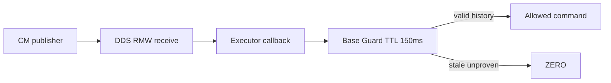

# 04편 — DDS/RMW·CM 수신 TTL·ZERO-only

## AXIA 실제 문제와 도메인 지식
이 실습은 AXIA의 DDS/RMW·CM 수신 TTL·ZERO-only 문제를 축약해 재현합니다. 데모는 실제 안전제어 노드나 인증 E-Stop이 아닙니다.

## 시스템·데이터 파이프라인


입력 → `axia_async_guard_lab/core.py`의 검사 함수 → 상태/등급 → 예상 결과. 오프라인 함수 호출이며 실제 ROS 메시지 발행이 아닙니다.

## 코드 해설과 학습 순서
1. `core.py`의 함수 이름과 입력 파라미터가 어떤 ROS 데이터를 모델링하는지 분석합니다.
2. `tests/test_contracts.py::Lab04`의 정상/경계/무효 케이스를 확인합니다.
3. 예외·UNKNOWN·ZERO·INCONCLUSIVE와 같은 보호 분기가 왜 필요한지 설명합니다.
4. NotImplementedError 구간을 한 함수씩 구현하여 RED → GREEN으로 변경합니다.

## 실행 (Python만 필요)
```bash
cd velog_domain_labs
export PYTHONPATH="$(find ros2_ws/src -mindepth 1 -maxdepth 1 -type d | paste -sd: -)"
python3 -m unittest discover -s tests -p 'test_contracts.py' -v
python3 -m axia_async_guard_lab
```
완성 후 예상 CLI 결과: `ZERO_STALE`. Student TODO는 미완료 함수에서 오류가 나는 것이 정상입니다.

## ROS 2 Jazzy colcon 설치 (선택·별도 L1)
```bash
source /opt/ros/jazzy/setup.bash
cd velog_domain_labs/ros2_ws
colcon build --packages-select axia_async_guard_lab --symlink-install
source install/setup.bash
ros2 run axia_async_guard_lab axia_async_guard_lab_demo
```

## AI 프롬프트 설계
- 일반: "로봇이 이상합니다. 고쳐 주세요."
- 도메인 기반: "DDS/RMW·CM 수신 TTL·ZERO-only의 기존 AXIA 계약을 설명하고 실패 원인과 최초 위반을 증명한 뒤, 실제 G07 코드 변경 없이 오프라인 RED 테스트를 작성하고 최소 구현으로 GREEN을 확인하세요."

## 검증 해석
Python 단위 PASS는 L0만 증명합니다. ROS2 DDS L1, Gazebo L2, WSL2 L3 인수 증거가 없다면 성공했다고 주장하지 않습니다.

## 코드 블록 해설 및 분산 타이밍 경계
- `now`와 `cm_received_at`는 **같은 monotonic clock** 기준입니다. ROS simulation header 시각을 단순 차감하지 마십시오.
- `now-cm_received_at > 0.15s`면 `ZERO_STALE,0`을 반환합니다. NaN은 `ZERO_INVALID,0`, CM 명령 0은 `ALLOW_ZERO,0`입니다.
- 최근 `SupervisorCommand`의 명령부호가 같고 120ms 이내이며 `|v_cm| <= 0.3|v_supervisor|+0.01`일 때만 `ALLOW_MATCHED`; 아니면 `ZERO_UNPROVEN,0`입니다.
- 120ms는 과거 명령 대조창이지 150ms CM TTL 연장이 아닙니다. 실제 AXIA Guard의 완전한 상태 머신이 아니라 개념 재현용 순수 Python 모델입니다.
- 입력 `now=10,cm_received_at=9.80,v=0.02` → `ZERO_STALE`; `now=10,cm_received_at=9.95,v=0.013,supervisor=(9.94,0.05)` → `ALLOW_MATCHED`.
- ROS 2 선택 읽기 전용 확인: `ros2 topic hz /cmd_vel_pre_guard` 및 안전 상태 Topic을 이용하되, 단순 hz 출력만으로 DDS Source→RMW→Executor의 내부 지연 원인을 확정하지 마십시오.
