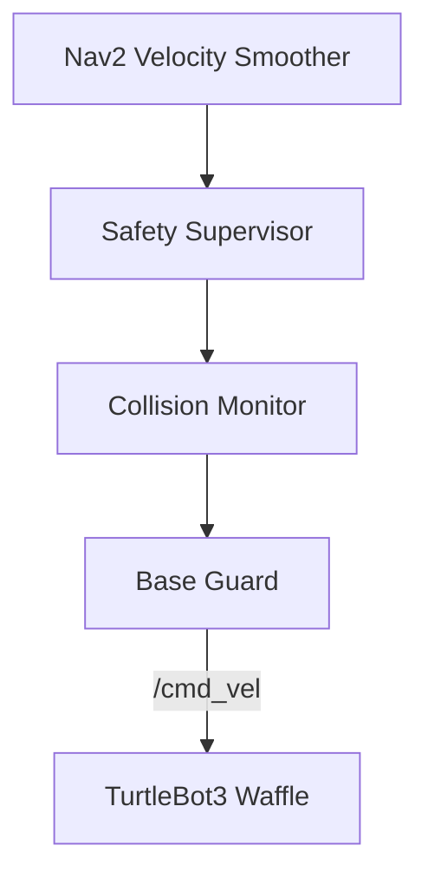

# 01편 — /cmd_vel 단일 소유권

## AXIA 실제 문제와 도메인 지식
이 실습은 AXIA의 /cmd_vel 단일 소유권 문제를 축약해 재현합니다. 데모는 실제 안전제어 노드나 인증 E-Stop이 아닙니다.

## 시스템·데이터 파이프라인


입력 → `axia_command_chain_lab/core.py`의 검사 함수 → 상태/등급 → 예상 결과. 오프라인 함수 호출이며 실제 ROS 메시지 발행이 아닙니다.

## 코드 해설과 학습 순서
1. `core.py`의 함수 이름과 입력 파라미터가 어떤 ROS 데이터를 모델링하는지 분석합니다.
2. `tests/test_contracts.py::Lab01`의 정상/경계/무효 케이스를 확인합니다.
3. 예외·UNKNOWN·ZERO·INCONCLUSIVE와 같은 보호 분기가 왜 필요한지 설명합니다.
4. NotImplementedError 구간을 한 함수씩 구현하여 RED → GREEN으로 변경합니다.

## 실행 (Python만 필요)
```bash
cd velog_domain_labs
export PYTHONPATH="$(find ros2_ws/src -mindepth 1 -maxdepth 1 -type d | paste -sd: -)"
python3 -m unittest discover -s tests -p 'test_contracts.py' -v
python3 -m axia_command_chain_lab
```
완성 후 예상 CLI 결과: `PASS`. Student TODO는 미완료 함수에서 오류가 나는 것이 정상입니다.

## ROS 2 Jazzy colcon 설치 (선택·별도 L1)
```bash
source /opt/ros/jazzy/setup.bash
cd velog_domain_labs/ros2_ws
colcon build --packages-select axia_command_chain_lab --symlink-install
source install/setup.bash
ros2 run axia_command_chain_lab axia_command_chain_lab_demo
```

## AI 프롬프트 설계
- 일반: "로봇이 이상합니다. 고쳐 주세요."
- 도메인 기반: "/cmd_vel 단일 소유권의 기존 AXIA 계약을 설명하고 실패 원인과 최초 위반을 증명한 뒤, 실제 G07 코드 변경 없이 오프라인 RED 테스트를 작성하고 최소 구현으로 GREEN을 확인하세요."

## 검증 해석
Python 단위 PASS는 L0만 증명합니다. ROS2 DDS L1, Gazebo L2, WSL2 L3 인수 증거가 없다면 성공했다고 주장하지 않습니다.

## 코드 블록 해설 및 실제 ROS 그래프 연결
- 입력 `publishers`는 **/cmd_vel 단일 Topic의 발행자 이름 목록**을 뜻합니다. 실 운용에서는 `ros2 topic info /cmd_vel --verbose`로 먼저 확인하십시오. 본 모델은 Topic QoS/노드 그래프의 실제 수집을 구현하지 않습니다.
- 첫 번째 분기는 **발행자가 0명**이면 `FAIL_MISSING`, 두 번째 분기는 **2명 이상**이면 `FAIL_DUPLICATE`, 세 번째 분기는 예상 소유자가 아니면 `FAIL_WRONG_OWNER`를 반환합니다.
- AXIA G07 최종 배선은 Nav2 → Supervisor → Collision Monitor → **Base Guard /cmd_vel**입니다. /cmd_vel Publisher 1명 검사는 **보안적 단독 제어권을 보장하지 않습니다.**
- 입력 `["p2_base_guard"]` → `PASS`, `["p2_base_guard","rogue"]` → `FAIL_DUPLICATE`.
- ROS 2 선택 읽기 전용 확인: `ros2 topic info /cmd_vel --verbose`, `ros2 topic type /cmd_vel`. 다른 노드가 있는 환경에서는 예상 이름을 직접 확인하고 조정하십시오.
