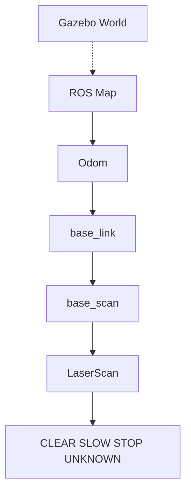

# 02편 — World·Map·Odom·LaserScan

## AXIA 실제 문제와 도메인 지식
이 실습은 AXIA의 World·Map·Odom·LaserScan 문제를 축약해 재현합니다. 데모는 실제 안전제어 노드나 인증 E-Stop이 아닙니다.

## 시스템·데이터 파이프라인


입력 → `axia_tf_scan_lab/core.py`의 검사 함수 → 상태/등급 → 예상 결과. 오프라인 함수 호출이며 실제 ROS 메시지 발행이 아닙니다.

## 코드 해설과 학습 순서
1. `core.py`의 함수 이름과 입력 파라미터가 어떤 ROS 데이터를 모델링하는지 분석합니다.
2. `tests/test_contracts.py::Lab02`의 정상/경계/무효 케이스를 확인합니다.
3. 예외·UNKNOWN·ZERO·INCONCLUSIVE와 같은 보호 분기가 왜 필요한지 설명합니다.
4. NotImplementedError 구간을 한 함수씩 구현하여 RED → GREEN으로 변경합니다.

## 실행 (Python만 필요)
```bash
cd velog_domain_labs
export PYTHONPATH="$(find ros2_ws/src -mindepth 1 -maxdepth 1 -type d | paste -sd: -)"
python3 -m unittest discover -s tests -p 'test_contracts.py' -v
python3 -m axia_tf_scan_lab
```
완성 후 예상 CLI 결과: `SLOW`. Student TODO는 미완료 함수에서 오류가 나는 것이 정상입니다.

## ROS 2 Jazzy colcon 설치 (선택·별도 L1)
```bash
source /opt/ros/jazzy/setup.bash
cd velog_domain_labs/ros2_ws
colcon build --packages-select axia_tf_scan_lab --symlink-install
source install/setup.bash
ros2 run axia_tf_scan_lab axia_tf_scan_lab_demo
```

## AI 프롬프트 설계
- 일반: "로봇이 이상합니다. 고쳐 주세요."
- 도메인 기반: "World·Map·Odom·LaserScan의 기존 AXIA 계약을 설명하고 실패 원인과 최초 위반을 증명한 뒤, 실제 G07 코드 변경 없이 오프라인 RED 테스트를 작성하고 최소 구현으로 GREEN을 확인하세요."

## 검증 해석
Python 단위 PASS는 L0만 증명합니다. ROS2 DDS L1, Gazebo L2, WSL2 L3 인수 증거가 없다면 성공했다고 주장하지 않습니다.

## 코드 블록 해설 및 실제 TF/LiDAR 연결
- `transform_point()`는 yaw 회전 행렬과 x/y 병진으로 **로컬 점을 부모좌표로** 옮깁니다. 실제 `map→odom→base_link→base_scan` 연결 전체는 tf2가 관리합니다.
- `front_distance()`는 `angle_min + i*angle_increment`로 각 빔의 방향을 계산하고, ±15° 섹터 내 유효 거리값 중 최솟값을 반환합니다. NaN/Inf, 범위를 벗어난 데이터는 제외하며 **모두 무효라면 None**입니다.
- `classify_zone()`는 `None→UNKNOWN`, `0.35m→STOP`, `0.65m→SLOW`, `1.20m→CLEAR`입니다.
- 본 1차원 거리 분류는 실제 공식 Collision Monitor의 다각형·포인트 수·TF와 동등하지 않습니다. 수치는 G07 교육용 시연 설정이며 물리적 안전거리 보증이 아닙니다.
- ROS 2 선택 읽기 전용 확인: `ros2 run tf2_ros tf2_echo map base_link`, `ros2 topic echo /scan --once`. `world`와 `map`을 동일 좌표로 간주하지 마십시오.
